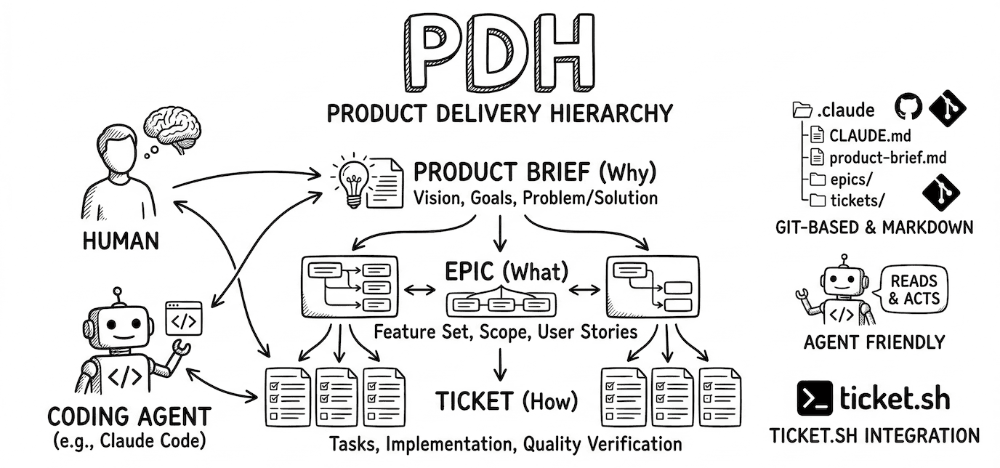

# PDH — Product Delivery Hierarchy

Product Brief（なぜ作るか）と ticket（いま何をやるか）の 2 層を、Git の Markdown に残す仕組み。coding agent が session・compact・bot run をまたいで作業を続け、人が実装前の AC と close を承認する。

## 前提条件

`git`・`curl`・`bash`・標準 Unix コマンド、Python 3.11 以降と PyYAML、Claude Code または Codex CLI を使う。review 評価コマンドを使う場合は `jq` と評価対象の CLI も必要。外部 API・CI・開発サーバの環境は各 project の規則で決める。

## セットアップ・アップデート

使う engine の導入手順を coding agent に読ませる。

- Claude Code: [claude/INSTALL.md](claude/INSTALL.md)
- Codex CLI: [codex/INSTALL.md](codex/INSTALL.md)
- GitHub bot（任意）: [github-bot/INSTALL.md](github-bot/INSTALL.md)

導入済みの更新は `pdh-update`。配置表は各 INSTALL にあり、「上書き / 差分マージ / 初回だけ」を区別する。共有 skill・worker・script の版は `.pdh-lock`、project の差分マージ対象の由来は `Based on` が持つ。

## ワークフロー (PDH stage flow)

`PDH-ticket-write` → `PDH-open` → `PDH-ticket-review` → `PDH-ticket-human-review` → `PDH-implement` → `PDH-review` → `PDH-verify` → `PDH-human-review` → `PDH-close`。

中断後は `pdh-resume` が note の Status と Checklist を読み、現在の stage から続ける。PM は `pdh-pm`、worker は役割定義を読む。詳細は [共有契約](docs/PDH-AGENTS.md)。

## main engine の選択

Claude Code は `.claude/skills/`、Codex 単独導入は `.agents/skills/` に skill を置く。Claude 併用では `.agents/skills/` を `.claude/skills/` への symlink にする。実装と review は既定で別 engine を使い、project の役割の設定で選ぶ。

### 対応している coding agent

Claude Code と Codex CLI の導入・更新手順を提供する。他の engine では project の規則・共有契約・skill を読めることと worker の起動・回収経路を確かめる。

## ファイル構成

導入先では `product-brief.md`、`PDH-AGENTS.md`、project の規則（`CLAUDE.md` または `AGENTS.md`）、`.ticket-config.yaml`、`tickets/<ticket>/ticket.md`・`note.md`・`progress.md` を持つ。skill・worker・共有 script は配置表どおりに置く。`scripts/test-all.sh`・開発サーバ・seed は project が実装する。

## このリポジトリの構成

```text
pdh/
  docs/PDH-AGENTS.md          # 共有契約
  docs/pdh-glossary.md        # 用語
  claude/
    INSTALL.md  lock-map.tsv
    skills/
      pdh-pm/                # SKILL.md / _execution-team.md / _open-ticket.md / _records.md
      pdh-ticket-write/  pdh-open/  pdh-resume/  pdh-ticket-review/
      pdh-implement/  pdh-review/  pdh-verify/  pdh-close/
      pdh-change/  pdh-check-writing/  pdh-update/  pdh-decision-board/
    templates/
      CLAUDE.md  AGENTS.md  product-brief.md  .ticket-config.yaml
      agents/claude/  agents/codex/  # pdh-* の役割ファイルだけを配置・lock する
      checks/  settings.json  hooks.json
      test-all.sh  dev-server.sh  seed-pdh-verify.sh
      check-pdh-ticket.sh  check-ticket-template-drift.sh  fast-checks.sh
      pdh-stage-checklist.sh  pdh-session-hook.sh  pdh-lock.sh
      pdh-review-range.sh  pdh-review-tally.sh  pdh-review-eval.sh
      pdh-related-docs.sh  pdh-verify-lib.sh  docs-policy.py  docs-toc.sh
      spawn-worker.sh  test-ticket-local.sh  gen-agents-md.sh  gen-codex-agents.sh
      pdh-review-eval/        # README と空の cases.json。実案件データは配らない
  codex/                     # ネイティブ配置・backup・移行の入口と、生成した skill・worker
    INSTALL.md  lock-map.tsv  skills/  templates/
  github-bot/                # 任意の coding-bot。pdh-gh-pull/ もここから配る
    INSTALL.md  _pdh.md  _github-issue.md  pdh-hooks.sh
    .github/  .devcontainer/  ROBOT.md
  scripts/                   # 配布元自身の検査と Codex 生成
  tests/                     # 一時導入先で共有 script の契約を検査
  evals/                     # 配布元の評価。配布しない
```

Codex 本文は `python3 scripts/gen-codex-distribution.py` で Claude 本文から生成する。ネイティブの INSTALL・AGENTS と退避・移行の経路は別に保守する。生成のずれと配置表・lock-map の対応は `bash scripts/test-all.sh` で検査する。
