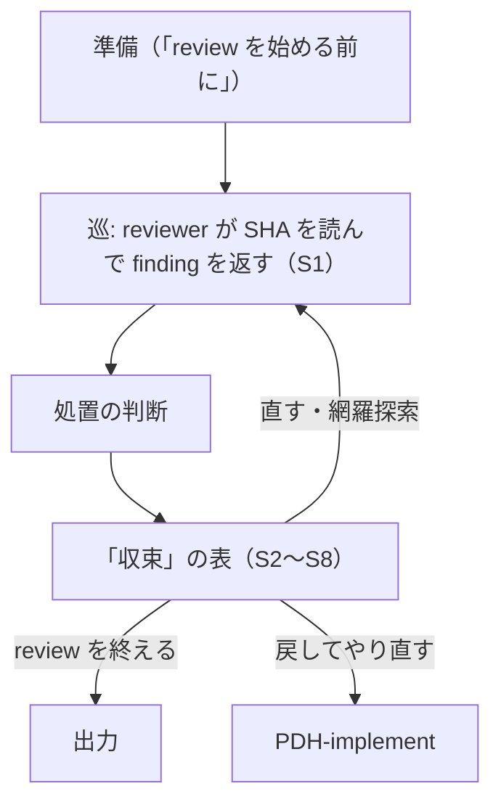

# PDH-review

PDH-review は、実装が終わった ticket の diff を受け取り、欠陥を finding として表に出し、処置を決めて、«いま直す» と決めたものを直し終えた状態を作る。
PM がこのファイルを読む。reviewer の手順は `.claude/agents/pdh-reviewer.md`、Why の見方の reviewer の手順は `.claude/agents/pdh-reviewer-lens1.md` の本文にある。

## 入力

- ticket が worktree で開かれていて、note の Status は `PDH-review`
- 実装の commit があり、`scripts/test-all.sh` の結果（CI に委ねる運用では、scoped test の実出力と委ねた先。形は `pdh-implement`「機械で確かめるもの」）と、完了報告の要点（確かめた結果・回せなかったもの・AC の書き換え案の有無）が progress にある
- 2 巡目以降と、中断から再開したときは、progress に `review-sha:` の行と `### Findings-PDH-review-N` 表がある
- PDH-human-review から差し戻されて実装をやり直した後は、差し戻しの理由が progress にある

## 処理

`bash scripts/docs-toc.sh --stage PDH-review` を実行し、出力の読む場面と見出しから ticket に関係する文書・節だけを開く。

«巡» は、reviewer が SHA を 1 つ読んで finding を返すまでの 1 回分を指す。巡の 2 つの種類は「巡」にある。



巡を起こす・止める判断は PM が「収束」で行う。

### review を始める前に

`pdh-stage-checklist.sh PDH-review --enter` は、review-sha の記録がまだ無い note に `<!-- pdh-review-loop: 1 -->` を付ける。この印がある ticket から照らし直しと収束の選択を機械で検査する。既に review を始めた note に後から印を付けず、done の記録も書き直さない。

- `git merge-base --is-ancestor origin/<base> HEAD` を確かめ、false なら `git merge origin/<base> --no-edit` してから review する（base は ticket frontmatter の `base_branch`。`ticket.sh new` はそこに `default` と書く。値が `default`（大文字小文字を問わない）・空・欄が無いときは `.ticket-config.yaml` の `merge_to`（古い設定の名前）、それも無ければ `default_branch` に読み替える。`./ticket.sh help` の `base_branch`）
- ticket に書かれていない consumer surface・破壊的な操作・権限の変更を、diff から機械的に列挙する。見つけたら頻度と 1 回のコストを添えて承認の PDH-stage へ出す
- reviewer の prompt に、review 対象の commit SHA と、ticket を始めた SHA（`bash scripts/pdh-review-range.sh [TICKET_DIR] --start` の値。«由来を記録する»）を書く。`[SKILLS_PATH]/pdh-pm/_execution-team.md`「review 専用 worktree」で起動前後の HEAD と作業ツリーを照合する
- 初回の review は reviewer を 1 人以上並行で起動し、同じ SHA の diff 全体を見せる（Why の見方 を除く）。最新 commit の diff（`<SHA>~1..<SHA>`）だけを渡すと、同じ ticket の前の commit が作った状態に起因する欠陥は原理的に見つからない。ユーザが reviewer の構成を指定したら、省略・短縮・統合で代えない。finding の修正は Coding Engineer に、テストの再実行は QA に任せる
- codex の reviewer の起動の仕方（`codex exec review` ではなく `codex exec` に指示文を渡す理由を含む）は `[SKILLS_PATH]/pdh-pm/_execution-team.md`「reviewer に `codex exec review` を使うとき」にある
- 初回の reviewer には diff 全体を渡す。AC の見方 は通常の reviewer が diff とともに行うので、AC・作り方の判断・実装者の完了の主張も渡す。Why の見方の reviewer には Why と、review 対象の SHA と、ticket を始めた SHA だけを渡す（下の「2 つの見方」）
- diff が下の «fail-open を先に探す diff の一覧» に当たるときは、そのうち少なくとも 1 つの review を、コードを書いた model とは別の model に行わせる
  - 別 model の review が完遂できないときは、別 model の reviewer に PM 自身のコードの読解を加えて代わりにし、その理由を progress に書く

#### fail-open を先に探す diff の一覧

次のどれかに当たる diff では、review を省かない。

- 認証・認可（session・token・scope・ACL・グループの判定）
- 破壊的な操作・元に戻せない操作と、そこへ至る経路
- DB の migration・schema の変更
- secret
- データの削除
- 課金
- deploy の手順
- 外部 API の契約
- 新しく公開する consumer surface（endpoint・MCP tool・CLI の subcommand など）

diff がどれかに当たるなら、reviewer は happy path より先に、拒否すべきものを通してしまう経路（fail-open）と誤用を探す。PM は初回の巡の reviewer の prompt に、この一覧を転記する。

### 2 つの見方

reviewer は diff を 2 つの見方で確かめる。«AC の見方» は通常の reviewer が網羅探索と一緒に行い、«Why の見方» は Why と 2 つの SHA だけを渡された専任の reviewer が行う。その reviewer には ticket・AC・実装者の結論を渡さないので、ticket の書き方に引きずられずに、Why が本当に満たされたかを見られる。

- AC の見方の reviewer: `.claude/agents/pdh-reviewer.md`
- Why の見方の reviewer: `.claude/agents/pdh-reviewer-lens1.md`

### 巡

- 巡は 2 種類ある。**網羅探索の巡**では、reviewer が diff 全体を読み、網羅探索と「diff の外を読む」を行う。初回の巡と、「収束」の表の S6・S8 が指す巡がこれに当たる
- **修正確認の巡**では、«いま直す» と判定した finding、再現条件、修正の diff、実装者が記録した修正前後の出力と «修正の証拠の対応表» を、同じ reviewer へ渡す。対応表の行ごとの確認結果を受け取る。広い探索の review を繰り返さない。Minor を直した差分も、影響する範囲をこの巡で読む。Minor の印だけでは巡を省かない — 小さい修正も退行を持ち込むからである
- 途中の巡では、変更したファイルと、その import の連鎖の上にある影響するテストだけを実行する
- 巡ごとに、reviewer が読んだ SHA を progress へ `review-sha:` の行で追記する（行の形は `[SKILLS_PATH]/pdh-pm/_records.md`）
- 修正の後、«いま直す» と判定した Critical / Major の件数と、修正前に落ちるテストの本数を突き合わせる。足りなければ修正完了とせず、欠けた検証を実装者へ返す（テストを置く規則は `.claude/agents/pdh-coding-engineer.md`「finding を直すときは、壊していないことを反例で固定する」）

### 処置の判断

この規則の目的: 使っていて困る失敗を直し、利用者が許す失敗を制約として残して出荷できること。reviewer の finding は仮説であり、実装の命令ではない。PM は次の 4 つで全件を判定する。PDH 自身の失敗の基準は `PDH-AGENTS.md`「失敗の許容」に従う。

1. 頻度（実測か根拠つきの推定）と 1 回のコストが Brief の «許す失敗の目安» に収まり、«許さない失敗» に当たらなければ、«いま直す» にせず «受け入れる» か «起票する» にする。頻度かコストが «未測定» でも、許さない失敗への到達経路が分かっているなら測らずに直す。それ以外は、測った結果で処置が変わりうるものだけを直す前に測る。件数・母数・期間・条件つきの頻度・人の作業時間のうち、処置を分けるために要るものを測る。測れなければ推定の値と根拠を Findings 表の «頻度と 1 回のコスト» に `推定:` と書く。
2. 実データを数えて 0 件で、合成した入力でしか再現しない finding は «起票する» にする。`実測 0 件` と書くなら、同じ列に数えた実データの母数と期間を書く。合成した入力だけで測ったものは `未測定` と書き、この理由で起票に回さない。ただし、この ticket の変更から到達できる許さない失敗の経路があれば、3 に従って直す。
3. 1 と 2 の例外として、この ticket の範囲（AC 未達・この ticket の退行・変更から到達できるもの・既存の振る舞いや契約の破壊・出荷済み欠陥の再発）の finding のうち、Brief の «許さない失敗» に当たるものは頻度に関係なく «いま直す» にする。範囲外の許さない失敗は «起票する» にして人に知らせる。
4. 前の巡と被害とそこに至る条件が同じなら、要旨に `同じ種類: PDH-review-<M> #<k>` と前の行を参照し、前の判定ではなく判定の根拠を引き継ぎ、同じ基準で判定する。新しい証拠で判定を変えるなら、表の後ろにその証拠を書く。被害か条件が違えば同じ種類にはしない。

処置の名前と行き先は次のとおり。

- **いま直す** — 上の基準で直す必要がある、この ticket の AC 未達・退行・変更から到達できる Critical・既存の振る舞いや契約の破壊・同じ根本原因による出荷済み欠陥の再発。この skill では «必須の修正» と呼ぶ。再発は、この変更・承認された目的・保つ契約に関わるものに限る。
- **受け入れる** — 目安に収まり許さない失敗に当たらない欠陥。この ticket の退行も含む。下の «契約の外の振る舞いと、制約の受け入れ» に従い、起票しない。
- **起票する** — 必須でなく、いつか直す欠陥と、この ticket に関わらない欠陥。close 前に新規か既存への集約で行き先を決める。範囲外の許さない失敗は人に知らせる。
- **記録だけ残す** — 欠陥でない観察・整備（テスト名・記録・文書の表現）。anchor を添え、必須の修正と同じ差分で直してもよいが、S2 の «いま直す» へ数えず、それだけでは修正確認の巡を起こさない。ただし、誤った文書が許さない失敗に直につながる場合（データを消す条件を誤記した仕様など）は «いま直す» にする。
- **棄却する** — コードや実出力で前提の誤りを示せる誤検出。根拠を要旨か表の後ろに残す。

承認済みの AC と Out-of-scope の外の要求（新しい利用者の要求・受け入れた finding の改善・新しい表示方式など）は «いま直す» にせず、別の ticket へ «起票する»。この ticket で直すなら、AC の変更の承認を先に取る。

«いま直す» が 8 件以上の巡の後は、Coding Engineer へ渡す前に全件を照らし直し、progress に `処置の照らし直し: PDH-review-<N> <全件を基準で照合した結果>` と書く。判定を変えた行は下の «Findings 表» の追記形式で残す。

基準で決まらない finding だけ、頻度と 1 回のコスト・足りない証拠を添えて利用者に聞く。答えは project の `CLAUDE.md` の基準に反映する。reviewer が finding なしで返した巡の «残るリスク» は、許さない失敗か目安を超える根拠なしに finding へ上げない。

根本原因が同じ形で他の箇所にもありうるなら、close の前にその箇所を列挙し、箇所ごとに処置を書く。«ほかにもあるかもしれない» のままでは close へ進まない。

- 先に裏取りをする。行うのは、同じ finding の統合と、コード上の事実誤認の除外だけである。棄却するのは、否定の根拠になるコードの行を引用できるときだけで、引用は要旨か表の後ろの判断の記録に書く。«推測的» «起きにくそう» だけでは棄却しない。次は行わない
  - ticket の記述だけを理由に棄却する・severity を下げる・対応済みとして扱う
  - 既存の問題（pre-existing）だからと無視する
  - 指定された役割・検査・承認を、別の手順で代える
- finding が承認済み AC の要求する動作を指している場合は、該当する AC とコード・テストで実際の動作を示し、Why との整合を判断する。AC も Why も満たし finding の前提が誤りなら、その前提とコードの根拠を理由に棄却する。AC を満たしても Why に届かないなら、棄却せず、ユーザの承認を得て AC を強めるか、別の ticket にする。未測定の外部 API の応答などの不足する証拠は、バグの判定と分けて記録する
- **契約の外の振る舞いと、制約の受け入れ。**この規則の目的: 初めから契約の外だった振る舞いと、欠陥を受け入れて契約を狭めた振る舞いを区別できること。
  - 承認済みの契約が範囲の外と定め、実際にその契約どおりに振る舞う finding は、契約の文と実出力を添えて «棄却する»
  - «受け入れる» が AC・Out-of-scope・公開の契約を狭めるなら、直す案と受け入れる案を実際の振る舞いの証拠とともに提示し、ユーザの承認を得て契約を変える。AC・Out-of-scope は再承認して `AC-approved:` を更新する。Why に届かなくなる案は、Why も合意し直すまで進めない
  - 許さない失敗や目安を超える欠陥は、基準を変える承認なしに受け入れない。受け入れた制約は「制約の受け入れの記録」に残す
- reviewer の間、または見方の間で結論が割れたら、全員の finding を足し合わせるだけや多数決で決めない。前提の差を確かめて決着する。各 reviewer の元の評価・異なる前提・決着に使ったコードの根拠・PM の最終評価を、表の後ろの判断の記録に残す
- `PDH-review-2` 以降で初回の finding が誤検出と分かったら棄却する。今回と無関係なら調べて分かったこととして記録し、元の AC と user journey だけを確かめる。2 巡目以降の発見も、«必須の修正» に当たるものだけをいま直す
- **由来を記録する。**この規則の目的: PM と承認者が、この ticket が持ち込んだ欠陥と、ticket の前からある欠陥を取り違えずに分けられること。PM は finding ごとに、欠陥が実在するか・どこから来たか・この ticket が直す責任を持つかを別々に判定する。実在するバグには、Findings 表の由来の列に次のどれかを書く。直前の巡の SHA と比べただけでは «既存» にしない — 同じ ticket の前の巡の修正が持ち込んだ欠陥も、直前の巡には既にあるからである
  - `由来: この ticket <commit か根拠>` — この ticket の commit が持ち込んだ（退行）。持ち込んだ commit（blame・bisect）か、開始 SHA では再現しない記録を添える
  - `由来: 既存 <開始 SHA>` — ticket を始めた SHA で同じ欠陥が起きる。持ち込んだ commit が blame・bisect で分かるときは、同じ由来の列に `持ち込み: <commit>` を添える。開始 SHA を持ち込みの commit として扱わない。出荷後の欠陥の集計が読むのは `持ち込み: <commit>` と `上流 <commit>` の SHA だけで、キーと SHA は backtick で囲まず、コロンは半角で書く。続けて «既存の証拠» を次のどちらかの形で書く
    - `再現:` 開始 SHA で実行したコマンドと、欠陥が出た出力
    - `経路:` 欠陥が起きる入口から欠陥の行までの呼び出しの連鎖（各段の、開始 SHA での path:行）と、`条件:` その入力が開始 SHA でも同じ連鎖を通り、欠陥の行で同じ結果になる条件（引数・分岐・設定・呼び出し側の前提）
    - 同じ行や同じ正規表現が開始 SHA にあるだけでは証拠にしない。この ticket が呼び出し側・入力・周りの条件を変えて、初めて欠陥に届くようにしたことがあるからである
  - `由来: 上流 <commit>` — ticket を始めた後に base から取り込んだ commit が持ち込んだ。その commit を添える
  - `由来: 未判定` — 開始 SHA での再現・blame・bisect で調べる。由来と許容の判断を分け、退行であることや severity だけで必須の修正にはしない。処置が決まらなければ、どこまで調べたかと足りない証拠を添えて人に聞く
  - 開始 SHA は、PDH-open が progress に書いた `start-sha:` の行の値である。`bash scripts/pdh-review-range.sh [TICKET_DIR] --start` が、その行・`[start]` の commit の親の順に探し、値と取り方を返す。どちらからも取れなければ、由来は «未判定» にする。ticket の `started_at` は確定値にせず、調べる手掛かりにだけ使う — 時刻の同値・書き換え・履歴の並びで、その時刻より前の最新の commit が開始の直前と一致する保証が無いからである。base との差（`HEAD ^origin/<base>`）からは求めない — base が ticket の commit を取り込むと値が変わるからである
- ユーザに聞いてから直す場合は `pdh-pm`「気づいたバグの行き先」にだけ書いてある
- 1 つの finding のために、永続の column / table・公開の endpoint・画面・権限・state の名前か遷移を 2 つ以上増やすことになるなら、自動で直すのを止めてユーザに相談する。1 つでも、より単純な案で AC か security の約束を満たせない理由を note に残す
- 修正のたびに、Coding Engineer の報告にある «足した部品» の一覧を巡ごとに並べ、この ticket の修正が足した部品（状態の項目・フラグ・分岐・見張りの job・後始末）の累計に、別の部品の欠陥を補うために足したものがあるかを問う。あれば、「収束」の表の段を待たずに S7 へ進んでよい。部品を補う部品が積み重なるのは、構造が合っていない合図だからである

### 収束

この規則の目的: PM が、巡が返るたびに次の 1 手をこの表から決め、直しても欠陥が尽きない review を、まず別の engine の前提の見直しで立て直し、それでも尽きなければ、利用者にしか決められない判断かを分けて次の手を決められること。

巡が返るたびに（S1）、PM は S2 から当てていき、行き先の段へ進む。巡を起こす・止める条件を変えるときは、文章の規則を足さずにこの表を直す。

| 段 | 判定の材料 | はい | いいえ |
|---|---|---|---|
| S2 | 最新の Findings 表に、判定が «いま直す» の finding がある（Minor を含む） | S2b | S6 |
| S2b | その «いま直す» のどれかが «処置の判断» の «必須の修正» に当たる（4 つの基準と、この ticket が直す範囲の両方） | S3 | 収束の出口（下） |
| S3 | 直したことが、同じ部品で次の «いま直す» を生んだ（severity と巡数は問わない） | S4 | S5 |
| S4 | この部品で、前の巡に S7 の前提の見直しを回した | S8 | S7 |
| S5 | `scripts/check-pdh-ticket.sh` が通る（PM は修正を Coding Engineer に渡す前に回す） | 直して S1 に戻る | 止まる（S7・S8 の答えを待つ） |
| S6 | diff が «fail-open を先に探す diff の一覧» に当たり、落ち着いた後の網羅探索がまだ | S1（網羅探索） | review を終える |
| S7 | 止める。頻度と 1 回のコストを添え、«作らない・止めて知らせる» 案を含む前提の見直しを別の engine の 1 人に回し、note の Checklist に «S7» と対象の通算巡と «発行先:» を含む行を書く。PM が結論から次の手を選ぶ | 作らない・止めて知らせる → 契約が変わるなら再承認 ／ 必須の修正に絞る → 下の «収束の出口» ／ もう 1 巡直す → S5 ／ 前提から書き直す → 書き直して網羅探索の巡へ（通算は数え続ける）／ 戻してやり直す → PDH-implement | — |
| S8 | S7 の結論と、その後の巡の finding の頻度と 1 回のコストを添え、`PDH-AGENTS.md`「確認が要るのは判断であって、調査ではない」の基準に当たる選択肢があるときだけ人に聞く。当たらなければ PM が決める。note の Checklist への記録は下の S8 の書式に従う | S7 と同じ選択肢 ／ ticket を先頭から書き直す・ticket の一部を書き直す → 書き直した AC と範囲の再承認を得て、網羅探索の巡へ（通算は数え続ける） | — |

- **収束の出口。**この規則の目的: 必須の修正が尽きた ticket が、残りの finding を別の作業へ渡して PDH-verify へ進めること。最新の Findings 表の «いま直す» を «処置の判断» の «必須の修正» と照らし直し、当たらないものを «受け入れる» か、いつか直すと決めたものだけ «起票する» に変える（表の後ろに «処置の変更» の行を追記する。下の「Findings 表」）。残った必須の修正があれば S5 へ進み、S5 が通ってから Coding Engineer に渡し、直した差分を修正確認の巡で読む（S1）。必須の修正が 0 件なら S6 へ進む。AC を狭める受け入れは再承認してから進む。PDH-verify と承認の PDH-stage は省かない
- 止まるか進むかの例。必須の修正をすべて直した後でも、S7・S8 の行が未回答なら止まる（S5 の «いいえ»）。S7 の結論で PM が «必須の修正に絞る» を選び、S7 の行を `[x]` にして直した後の修正確認の巡で «いま直す» が 0 件なら、S6 を経て PDH-verify へ進む。S8 で人が «必須の修正に絞る» と答え、progress に答えを書いて S8 の行を `[x]` にした後も同じである。修正確認の巡で、同じ部品の修正が次の «いま直す» を生めば、S3 から当て直す
- S2b を置くのは、巡数では止まらないからである。独立した Minor に «いま直す» を付け続けると S2 → S3（いいえ）→ S5 → 直して S1 を回り続け、許容と照らし直す段が S7 の後の «収束の出口» にしか無い（実測: 同じ ticket で 9 巡）。S2b は巡を止めるのではなく、処置を «処置の判断» と照らし直す段である
- 通算の巡は、progress の有効な `review-sha:` の異なる SHA の数である。同じ SHA の訂正の追記は数えない。Findings 表の見出しの N を通算の巡にし、書き直しや差し戻しの後も数え直さない
- S7 の見直しの後も、同じ部品の修正が次の «いま直す» を生んだら S8 で判断を分ける。
- S8 で選ぶ前に S7 の見直しの結論を照合する。人に聞く場合も PM が決める場合も、ticket（Why・AC・範囲）の前提から検討する
- S6 の網羅探索は、承認者に聞かずに回す。回さないのは、承認者が AC の承認で覆したときだけである（`[SKILLS_PATH]/pdh-decision-board/ticket-gate.md`「本文の固定部」の «決めること»）
- «前提から書き直す» では、`.claude/agents/pdh-coding-engineer.md`「finding を直すときは、壊していないことを反例で固定する」の順序で、再現テスト・«まとめる»・«直す» の差分を分ける。AC が変わるなら、S7 でも S8 でも、ユーザの承認を得て再合意する
- 同じ部品の修正と次の finding の因果は PM が判断し、下の Checklist に根拠を残す。`scripts/check-pdh-ticket.sh` は未回答の S7・S8 を残した次の巡と PDH-verify 以降への移行を止める

**S7 の前提の見直し**は、経緯を持たない worker 1 人に回す。engine は PM と別にし、速い model と `medium` を使う（`[SKILLS_PATH]/pdh-pm/_execution-team.md`「エンジン割り当て」）。PM と同じ engine の worker は、PM と同じところを見落とし、PM の考えた枠の中で案を組み替えがちだからである。

- 渡すのは、依頼の原文・Why・AC・`product-brief.md` の全体・失敗の種類ごとの頻度と 1 回のコストの根拠・外の契約（API などの仕様）・ticket の前の base のコードと文書と、それまでの Findings の要旨を «構造で起きなくしたい失敗» の種類として整理した一覧である。今の差分・Findings 表・note・progress・PM の考えた案は渡さない。今の作りの局所的な組み替えではなく、前提から案を出させるためである
- 問いは «本当に難しいのは何かと、問題の立て方・AC・責任の置き場所のどこに無理があるかを挙げる。前提（状態をどこに持つか・誰が何を知るか・何に任せられるか）を疑い、«作らない・止めて知らせる» 案を必ず含めて案を出し、案ごとにその場面の頻度と 1 回のコスト（実測か推定かと根拠）・どの失敗が構造で起きなくなるか・AC と API の変更・作る量・確かめやすさ・作る前に確かめる前提を書く。今の実装を直し続ける場合との比べと、進め方の問題も書く。依頼の範囲を超える案は、この ticket の案ではなく起票の候補として分けて書く» である
- PM は結論から次の手を選び、選んだ手と理由・覆す条件を progress に書いて、S7 の行を `[x]` にする。利用者にしか決められない選択肢が S7 で出たら S8 で聞く。結論が作る前に確かめる前提を挙げたら、書き直す前に確かめる
- S8 で検討する選択肢は «必須の修正に絞る / もう 1 巡直す / 作らない・止めて知らせる / 前提から書き直す（案ごと）/ 戻してやり直す / ticket を先頭から書き直す / ticket の一部を書き直す» である。S8 に来たのは、別の engine の見直しの後も同じ部品の修正が欠陥を生んだからなので、コードの直し方より先に ticket（Why・AC・範囲）の前提を疑う
  - «ticket を先頭から書き直す» は、依頼の原文と Why から AC と範囲を書き直して再承認を得る。«ticket の一部を書き直す» は、欠陥が集まった部分の AC を絞るか別の ticket に分けて再承認を得る。この 2 つは、推奨でなくても検討から外さない。人に渡すのは、選ぶ理由があり判断の基準に当たる案だけにする（`PDH-AGENTS.md`「確認が要るのは判断であって、調査ではない」）
  - 選択肢ごとに PM が考えて、範囲（依頼の原文のどの文に当たるか）・対応策（何を直す・戻す・起票するか）・製品の利用者にとって変わるところ（画面・操作・振る舞い）・AC の変更と再承認の要否を書き、人がそれだけで選べるようにする
  - «必須の修正に絞る» には、起票する finding の一覧を添える。

この規則の目的: PM が、効かなかった前提を変え、次の手が外れたかを記録から判断できること。S8 に既定の案を置かない。部品ごとに、修正由来の «いま直す» の割合・同じ修正の往復・別の部品を補う部品の累積を読み、次の手を選ぶ。選んだ手を progress の次の 1 行に書く。

`収束の選択: PDH-review-<N> 部品=<名前> 前の仮説=<前の手が前提にしたこと> 外れ方=<どう外れたか> 次に変えるもの=<何を変えるか> 外れの条件=<この手が外れたと判断する条件>`

収束の選択は行頭から書く（行頭の `- ` は付けてもよい）。訂正は同じ巡と部品の完全な行を追記する。部品が読めない行は、同じ巡に後から完全な行を追記する。別の部品の空欄は、その部品の行を訂正する。

**S8 の書式**: 人に聞くときは、Checklist に `- [ ] S8 PDH-review-<通算巡> 利用者の判断が要る理由: <基準に当たる変化> 発行先: <URL か path>` と書く。答えを progress と ticket に反映して `[x]` にする。PM が決めるときは `- [x] S8 PDH-review-<通算巡> PM が決めた: <決めたこと> 覆す条件: <条件>` と書き、同じ内容を progress に残す。後者には発行先を付けない。判断を記録してから `bash scripts/check-pdh-ticket.sh` を回す。機械は S8 の巡の直後のラベルと同じ行の発行先または覆す条件のラベル、および上の収束の選択の行と空欄を数え、理由・決定・覆す条件・発行先の中身は下の判断の Checklist で PM が確かめる。

### Findings 表

finding は、処置の判断で判定と理由まで決めてから、progress の `### Findings-PDH-review-N` 表へ 1 行足す。2 巡目以降と、修正確認で出た新しい finding も同じ形で足す。

- progress は追記だけである。既に書いた行を後から変えると close が止まるので、空欄の行を先に足して後で埋める書き方はしない
- 判定を決める前に記録を残したいときは、reviewer の報告の要点を progress へ追記する。表の行は判定が決まってから足す
- 足した後で処置が変わったら、元の行は書き換えず、表の後ろに finding の識別子（表の `#` と見出しの巡、例: `PDH-review-1 #3`）を付けて «処置の変更: 起票する → いま直す — 理由» の行を追記する（`[SKILLS_PATH]/pdh-decision-board/close-gate.md` と同じ書き方）

```
| # | 要旨 | 頻度と 1 回のコスト | 判定 | 由来 |
|---|---|---|---|---|
```

要旨には部品と問題、由来には「由来を記録する」の根拠を書く。頻度は実測か推定か、% か月の回数と根拠を、1 回のコストは誰の何分・いくらかを書く。誤検出や観察も、問題とした場面の頻度とコストを書く（該当しなければ 0 とその理由）。列名は空白も含めて上の表から写す。誤記を訂正するときは、同じ巡の見出しと表に同じ番号の正しい行を追記する。検査と集計は同じ巡・番号の最後の読める行を使い、読めない番号は行として数えない。番号は読めて他の欄が崩れた行は、同じ番号の正しい行を後から追記するまで検査が止まる。HTML コメント内は記録に数えず、印のある ticket は done へ移した後も同じ読み方を使う。判定のセルには いま直す / 受け入れる / 起票する / 記録だけ残す / 棄却する のいずれかだけを書く。判断の理由と根拠は要旨か表の後ろに finding の識別子を添えて残す。承認者にもこの 5 列の表をそのまま見せる。

`scripts/check-pdh-ticket.sh` は現行の表の «頻度と 1 回のコスト» が空なら落とす。旧 8 列の表は書き換えないが、認めるのはこの検査が入る前に作った ticket だけである — それより後に作った ticket の progress に現行 5 列の表が 1 つも無ければ落ちるので、次の巡から 5 列で追記する。`bash scripts/pdh-review-tally.sh` は現行表の判定と巡を数える。出荷後の欠陥は、別 ticket の由来の `持ち込み: <commit>` と `上流 <commit>` の SHA だけを読み、件名の `[ticket 名]` で done の ticket を指す行を数える（棄却と観察を除く。同じ行が同じ ticket を複数回指しても 1 件）。集計する ticket を指定するときは起票元と欠陥を記録した後続の両方を含める。

過去の欠陥と対照の評価セットは、`bash scripts/pdh-review-eval.sh --cases <cases.json> --measured`（1 件だけなら `--case <id>`）で reviewer ごとに測る。評価の実行は CI に入れない。

判定が `起票する` の行は、close の前に同じ欠陥を検索し、`./ticket.sh new` で新しく作るか既存へ集約するかで行き先を確定する（下の「同じ欠陥の ticket があるとき」）。GitHub の issue を起票先にする project では、`github-bot/_github-issue.md`「review の finding を issue にする」の手順に従う。そのうえで note の `## Checklist` に `- [ ] 起票: <anchor> → <ticket 名>` を 1 行書く。`scripts/check-pdh-ticket.sh` が `→` の後の名前の ticket が `tickets/` か `tickets/done/` に実在するかを確かめ、`require_checklist` が未了の間 close を拒否する。

#### 制約の受け入れの記録

この規則の目的: 受け入れた制約を、次に同じ箇所を変える人が見つけ、振る舞いの変化をテストで検知できること。`CLAUDE.md` が定める文書（既定 `docs/known-limits.md`）へ、制約ごとに 1 行書く。

`- <何が起きるか> / <頻度と 1 回のコスト。実測か推定かと根拠> / <anchor> / <見張り: テストの path か「テストなし」> / <見直す条件>`

再現できる制約には、今の振る舞いを確かめるふつうのテストを置き、名前を «制約: » で始めて制約の行への参照を付ける。`test.fails` / `xfail` は使わない。直ってテストが落ちたら、振る舞いを確かめて行と制約のテストを消す。再現できないものは «テストなし» と書く。anchor のコードが変わったら、その行を消すか書き直す。見張りと行の整合は下の Checklist で PM が確かめる。

#### 起票した ticket に書くこと

この規則の目的: 起票した ticket を後で拾う人が、起票元の会話を読まずに、いつ・なぜ拾うかを決められること。新しく作る ticket の `Why` に、`pdh-ticket-write`「Why を書く」の行に加えて次を書く。項目名と値は、検査と検索が読むので、下の表記のまま半角の `:` で書き、訳さない。

- `derived-from:` 起票元の ticket 名。同じ欠陥の再発で前の ticket も指すなら、名前を並べる
- `pickup-timing:` 次の 3 つのどれか。«いつ着手するか» の目安であり、着手を自動で起こすものではない
  - `immediate` — この ticket の範囲外だが、放置すると害が続く。起票元の ticket の «いま直す» には戻さない。PM は起票した時点で人に知らせ、起票元の note の Checklist に、起票先の名前と `発行先:` を含む行を書く（`PDH-AGENTS.md`「受け渡し経路」）
  - `next-selection` — 次に着手する ticket を選ぶときの候補にする
  - `when-touching` — 同じ箇所を変える ticket が PDH-ticket-review で拾う（`pdh-ticket-review` の Checklist の行）
- `Reproduction-or-measurement:` finding の証拠（`再現:` か `経路:` と `条件:`）をそのまま写す
- `Why-not-fix-now:` 起票元の ticket の «必須の修正» に当たらない理由。直す手間や規模は理由にしない — 安く直せても、必須の修正でなければ別の ticket にする
- 後から検索できる anchor（Checklist の `起票:` の行と同じもの）

`scripts/check-pdh-ticket.sh` は、起票元の Status が PDH-review 以降のとき、この branch で新しく作った起票先に `derived-from:`・`pickup-timing:` があり、`Why-not-fix-now:` が «該当なし» でないことを数える。`immediate` なら、起票元の Checklist の `発行先:` の行も数える。既存の ticket への集約と、各検査が入る前に作った ticket は数えない。

#### 同じ欠陥の ticket があるとき

この規則の目的: 同じ欠陥の ticket が増えず、違う欠陥が既存の ticket に吸い込まれないこと。新しく作る前に、tickets と tickets/done を検索する（GitHub の issue を起票先にする project では、issue も。`github-bot/_github-issue.md`）。

- 同じかどうかは、原因・対象（anchor）・期待する修正の 3 つが同じかで決める。症状が似ているだけでは同じにしない
- 同じ ticket が見つかったら、その状態で分ける
  - 未完了 — 集約する。`起票:` の行の `→` の後にその ticket の名前を書き、新しく作らない
  - done で直した記録がある — その修正の後でも起きるかを確かめる。起きるなら再発として新しく作り、`derived-from:` に起票元と前の ticket を並べる。起きないなら新しく作らず、理由を Findings 表の由来の列に書く
  - 中止（CANCELED）・却下 — 中止した理由を読む。理由がいまも当てはまるなら新しく作らず、当てはまらなくなったなら、その差を書いて新しく作る
  - 重複として閉じた — 重複先の ticket をたどり、その状態で上の分け方を当てる
- 集約するとき、ほかの ticket のファイル（ticket・note・progress）は書き換えない。その ticket の担当の作業と競合するからである。証拠と anchor は起票元の progress に書き、Checklist の `起票:` の行で結ぶ。その ticket を拾う人は、`git grep -n '起票:.*→ <ticket 名>'` で tickets と tickets/done から集約された finding を見つける
- 共有するコード（別の repo が持つライブラリ・配布物）の欠陥は、修正を持つ repo へ起票するのが基本である。手元の repo には、その起票先への参照を残す（GitHub の issue なら `github-bot/_github-issue.md`「review の finding を issue にする」）

この PDH-stage の最後に、下の「出力」を確かめる。

### 記録だけの差分

review の入力を保ったまま結果を受け取れるよう、記録の範囲は、設定された tickets_dir 配下にあるすべての ticket のディレクトリ全体（done を含む）とする。`note.md`・`progress.md`・`related-docs.md`・検査の証拠もこの範囲に入る。`scripts/pdh-review-range.sh` は、この定義で各 ticket の記録を除外する。

repo root で `source scripts/pdh-review-range.sh` と `pdh_review_tickets_dir` を実行し、設定された記録の root を `pdh_tickets` に得る。固定して渡した SHA を `review_sha` に指定し、`git diff --exit-code "$review_sha" HEAD -- . ":(top,exclude)$pdh_tickets"` が 0 で終わることを確かめる。除外したすべての ticket 内の差分も読み、review の入力（AC・作り方の判断・検証対象）を変えていないか判断する。`ticket.md` の AC と Out-of-scope は、`scripts/check-pdh-ticket.sh` の `AC-approved:` の hash 検査で承認後の変更を照合する。再承認で hash を更新した場合も、固定 SHA の `ticket.md` と比較して AC・Out-of-scope が変わっていたら、影響する review を新しい SHA でやり直す。

記録だけなら固定 SHA の結果を保ち、比較した 2 つの SHA・コマンド・出力・判断を progress に残す。入力やコードが変わったら、影響する review を新しい SHA でやり直す。

## 出力

最新の SHA で «いま直す» と決めた Critical と Major が直っていて、すべての finding の行方が progress の Findings 表から読める。

`- [ ] PDH-review:` で始まる行は、この PDH-stage のチェックリストである。この PDH-stage に入るとき、`bash scripts/pdh-stage-checklist.sh PDH-review --enter [TICKET_DIR]/note.md` が note の `## Checklist` へ写す。確かめたら `[x]` にし、当てはまらない行は `- [-] ... - skip: <理由>` にする。

チェックリストの行の「review を始める前に」の一覧は、このファイルの «fail-open を先に探す diff の一覧» である。「diff の外を読む」は `.claude/agents/pdh-reviewer.md` の節である。

### 機械で確かめるもの

- [ ] PDH-review: `bash scripts/fast-checks.sh` が 0 で終わった

### 判断で確かめるもの

- [ ] PDH-review: PM が Findings 全件を「処置の判断」の 4 つの規則で照合し、同じ種類の参照・母数と期間・判定を変えた証拠が progress にある
- [ ] PDH-review: PM が整備だけで修正確認の巡を起こしておらず、AC と Out-of-scope の外の要求を起票か AC の再承認へ回したことを Findings 表と巡の記録で照合した
- [ ] PDH-review: 修正の証拠の対応表があり、修正確認の巡の reviewer が行ごとの確認結果を返した
- [ ] PDH-review: PM が収束の選択の前の仮説・外れ方・次に変えるものを照合し、前の手と次の手が本当に違うと判断した根拠が progress にある

- [ ] PDH-review: PM が S7・S8 の各行の理由・決定・覆す条件・発行先の中身を確かめ、利用者の判断が要る理由か PM の決定が判断の基準と progress の結論に合っている

- [ ] PDH-review: finding の頻度と 1 回のコストを Failure Tolerance と照合し、受け入れた制約は 1 行の記録と今の振る舞いを確かめるテスト（再現できなければ「テストなし」）がある。AC を狭めた場合は再承認済みである
- [ ] PDH-review: 直したことが同じ部品で次の «いま直す» を生んだかと根拠が progress にあり、生んだ場合は S7（見直し後なら S8）の回答を反映した。案に «作らない・止めて知らせる» と頻度・1 回のコストがある

- [ ] PDH-review: reviewer の専用 worktree の HEAD と作業ツリーを起動前後に照合し、結果が progress にある
- [ ] PDH-review: 最後の巡で reviewer が読んだ SHA が、progress に `review-sha:` の行で残っている。ref が進んだ場合は、記録だけと判定した比較か、新しい SHA の review 結果がある

- [ ] PDH-review: 初回の巡で、reviewer が「diff の外を読む」の 3 つ（周りの文脈・git の履歴・変わるべきだった箇所）を行い、読んだ commit を報告に書いた
- [ ] PDH-review: 初回の巡で、reviewer が同じ SHA の diff 全体を読んだ。「review を始める前に」の一覧に当たる diff では、少なくとも 1 つの review を、コードを書いた model と別の model が行った
- [ ] PDH-review: 通常の reviewer の報告に、全 AC と全 Design-Decisions の実装・検証の対応表があり、未実装・未確認も明記されている。修正確認の巡は影響する行を更新した（Why だけを渡す pdh-reviewer-lens1 は対象外）
- [ ] PDH-review: 最新の SHA で «いま直す» と判定した Critical と Major が解消し、結果が `### Findings-PDH-review-N` 表にある
- [ ] PDH-review: «いま直す» と判定した Critical / Major の件数と、修正前に落ちるテストの本数が合っている。組み直した場合は再現テスト→挙動を保つ整理→挙動の修正の順序と各段階の出力がある
- [ ] PDH-review: 修正のたびに、Coding Engineer の報告に足した部品の一覧と、そのうち別の部品の欠陥を補うもの（無ければ 0 件）があり、PM が巡ごとに並べて見た（「処置の判断」）
- [ ] PDH-review: reviewer の見方が割れた finding は、元の評価・前提の差・コードの根拠・PM の最終評価が表の後ろの判断の記録から辿れる。«いま直す» 以外と判定した finding すべてに判定の理由があり、`起票する` と判定した ticket は作ってある

## 例外

- **reviewer が review を完遂できない**（sandbox が起動しない・timeout・API のエラー・空の結論）: その巡の結果は使わない。原因を確かめて同じ SHA で起動し直す。別 model の reviewer がどうしても完遂できないときは、PM 自身のコードの読解で代え、その理由を progress に書く（「review を始める前に」）
- **review の途中で、review 対象の ref に commit が積まれた**: 固定して渡した SHA の結果として受け取り、「記録だけの差分」の比較と判定に従う。
- **中断した**（compact・session の終了・timeout）: progress の最後の `review-sha:` と Findings 表で、どの巡のどこまで済んだかを確かめる。結果ファイルの無い reviewer の巡は、同じ SHA で最初からやり直す
- **現在の ticket と無関係な、実在する Critical / Major を見つけた**: «必須の修正» に当たるか（この ticket の変更が通る経路から到達できる Critical か）で処置を決め、当たらなければ起票する（「処置の判断」）。ユーザへ持ち込むのは、`pdh-pm`「気づいたバグの行き先」がユーザに聞くと定めた場合だけである
- PM が自動で進めずにユーザへ戻す条件（修正が永続の column・公開 endpoint・権限などを増やす、AC が緩くて Why に届かない、「収束」の S8 で利用者の判断が要るとき）は「処置の判断」と「収束」にある
