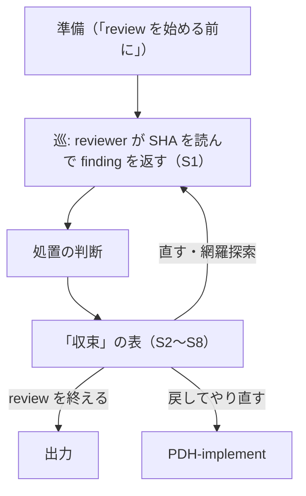

# PDH-review

PDH-review は、実装が終わった ticket の diff を受け取り、欠陥を finding として表に出し、処置を決めて、«いま直す» と決めたものを直し終えた状態を作る。
PM がこのファイルを読む。reviewer の手順は `.codex/agents/pdh-reviewer.toml`、Why の見方の reviewer の手順は `.codex/agents/pdh-reviewer-lens1.toml` の本文にある。

## 入力

- ticket が worktree で開かれていて、note の Status は `PDH-review`
- 実装の commit があり、`scripts/test-all.sh` の結果（CI に委ねる運用では、scoped test の実出力と委ねた先。形は `pdh-implement`「機械で確かめるもの」）と、完了報告の要点（確かめた結果・回せなかったもの・AC の書き換え案の有無）が progress にある
- 2 巡目以降と、中断から再開したときは、progress に `review-sha:` の行と `### Findings-PDH-review-N` 表がある
- PDH-human-review から差し戻されて実装をやり直した後は、差し戻しの理由が progress にある

## 処理

`bash scripts/docs-toc.sh --stage PDH-review` を実行し、出力の読む場面と見出しから ticket に関係する文書・節だけを開く。

«巡» は、reviewer が SHA を 1 つ読んで finding を返すまでの 1 回分を指す。巡の 2 つの種類は「巡」にある。



巡を起こす・止める判断は PM が「収束」で行う。

### review を始める前に

- `git merge-base --is-ancestor origin/<base> HEAD` を確かめ、false なら `git merge origin/<base> --no-edit` してから review する（base は ticket frontmatter の `base_branch`。`ticket.sh new` はそこに `default` と書く。値が `default`（大文字小文字を問わない）・空・欄が無いときは `.ticket-config.yaml` の `merge_to`（古い設定の名前）、それも無ければ `default_branch` に読み替える。`./ticket.sh help` の `base_branch`）
- ticket に書かれていない consumer surface・破壊的な操作・権限の変更を、diff から機械的に列挙する。見つけたら Critical として承認の PDH-stage へ出す
- reviewer の prompt に、review 対象の commit SHA を書く。`[SKILLS_PATH]/pdh-pm/_execution-team.md`「review 専用 worktree」で起動前後の HEAD と作業ツリーを照合する
- 初回の review は reviewer を 1 人以上並行で起動し、同じ SHA の diff 全体を見せる（Why の見方 を除く）。最新 commit の diff（`<SHA>~1..<SHA>`）だけを渡すと、同じ ticket の前の commit が作った状態に起因する欠陥は原理的に見つからない。ユーザが reviewer の構成を指定したら、省略・短縮・統合で代えない。finding の修正は Coding Engineer に、テストの再実行は QA に任せる
- codex の reviewer の起動の仕方（`codex exec review` ではなく `codex exec` に指示文を渡す理由を含む）は `[SKILLS_PATH]/pdh-pm/_execution-team.md`「reviewer に `codex exec review` を使うとき」にある
- 初回の reviewer には diff 全体を渡す。AC の見方 は通常の reviewer が diff とともに行うので、AC・作り方の判断・実装者の完了の主張も渡す。Why の見方の reviewer には Why だけを渡す（下の「2 つの見方」）
- diff が下の «fail-open を先に探す diff の一覧» に当たるときは、review を省かない。そのうち少なくとも 1 つの review を、コードを書いた model とは別の model に行わせる
  - 別 model の review が完遂できないときは、別 model の reviewer に PM 自身のコードの読解を加えて代わりにし、その理由を progress に書く

#### fail-open を先に探す diff の一覧

次のどれかに当たる diff では、review を省かない。

- 認証・認可（session・token・scope・ACL・グループの判定）
- 破壊的な操作・元に戻せない操作と、そこへ至る経路
- DB の migration・schema の変更
- secret
- データの削除
- 課金
- deploy の手順
- 外部 API の契約
- 新しく公開する consumer surface（endpoint・MCP tool・CLI の subcommand など）

diff がどれかに当たるなら、reviewer は happy path より先に、拒否すべきものを通してしまう経路（fail-open）と誤用を探す。PM は初回の巡の reviewer の prompt に、この一覧を転記する。

### 2 つの見方

reviewer は diff を 2 つの見方で確かめる。«AC の見方» は通常の reviewer が網羅探索と一緒に行い、«Why の見方» は Why だけを渡された専任の reviewer が行う。その reviewer には ticket・AC・実装者の結論を渡さないので、ticket の書き方に引きずられずに、Why が本当に満たされたかを見られる。

- AC の見方の reviewer: `.codex/agents/pdh-reviewer.toml`
- Why の見方の reviewer: `.codex/agents/pdh-reviewer-lens1.toml`

### 巡

- 巡は 2 種類ある。**網羅探索の巡**では、reviewer が diff 全体を読み、網羅探索と「diff の外を読む」を行う。初回の巡と、「収束」の表の S6・S8 が指す巡がこれに当たる
- **修正確認の巡**では、«いま直す» と判定した finding、再現条件、修正の diff、実装者が記録した修正前後の出力だけを、同じ reviewer へ渡す。広い探索の review を繰り返さない
- 途中の巡では、変更したファイルと、その import の連鎖の上にある影響するテストだけを実行する
- 巡ごとに、reviewer が読んだ SHA を progress へ `review-sha:` の行で追記する（行の形は `[SKILLS_PATH]/pdh-pm/_records.md`）
- 修正の後、«いま直す» と判定した Critical / Major の件数と、修正前に落ちるテストの本数を突き合わせる。足りなければ、それ自体を finding にする（テストを置く規則は `.codex/agents/pdh-coding-engineer.toml`「finding を直すときは、壊していないことを反例で固定する」）

### 処置の判断

reviewer の finding は仮説であり、実装の命令ではない。PM は finding ごとに、AC・現在の diff・この ticket が変える user journey・実際に出荷された欠陥と同じ根本原因のどれかに結び付けて、次の 4 つの処置から 1 つを選ぶ。severity だけでは、ticket の範囲を広げる理由にならない。

- **いま直す** — 既定である。次のどれかに当たる finding は、この ticket で直す
  - 直さないと AC を満たさない
  - 現在の diff が退行を起こした
  - 同じ根本原因が、実際に出荷された欠陥を再発させうる
  - Critical / Major のために、この ticket が変える・必要とする user journey が成り立たない
  - この ticket の Why を共有していて、直すことが ticket を広げるのではなく完成させる。このときは、修正を AC・diff・共有する Why へ結び付ける 1 行を progress に書く
  - 規模と手間は、それだけではいま直さない理由にならない。安く直せることは、それだけでいま直す理由になる
- **起票する** — 次の 2 つを両方満たすときだけ選ぶ。片方だけでは選ばない
  - その finding の Why が単独で成立し、独立した作業として予定する価値がある
  - ここで直すと高くつく（直す差分が、この ticket 本来の差分より大きくなる見込み）
  - 起票する ticket は close の前に作る（下の「Findings 表」）。作れないなら、いま直すか記録だけ残すを選ぶ。«あとで起票する» は処置ではない
- **記録だけ残す** — 実在するが、ticket にする価値が無く、いまやりもしないもの
  - 後から検索できる anchor（シンボル名・ファイルパス・endpoint・設定キー）を 1 つ以上付ける。anchor を付けられない finding は、後から使うには曖昧すぎるので、書き直すか棄却する
  - 実在するバグにはこの処置を選ばない（下の «既存のバグ»）
- **棄却する** — 誤検出か、前提の誤り（下の «先に裏取りをする»）

独立した ticket にする価値は無いがやる価値はある finding は、起票せずにいま直す。根本原因が同じ形で他の箇所にもありうるなら、close の前にその箇所を列挙し、箇所ごとに処置を書く。«ほかにもあるかもしれない» のままでは close へ進まない。

- 先に裏取りをする。行うのは、同じ finding の統合と、コード上の事実誤認の除外だけである。棄却するのは、否定の根拠になるコードの行を引用できるときだけで、引用は Findings 表の理由の列に書く。«推測的» «起きにくそう» だけでは棄却しない。次は行わない
  - ticket の記述だけを理由に棄却する・severity を下げる・対応済みとして扱う
  - 既存の問題（pre-existing）だからと無視する
  - 指定された役割・検査・承認を、別の手順で代える
- finding が承認済み AC の要求する動作を指している場合は、該当する AC とコード・テストで実際の動作を示し、Why との整合を判断する。AC も Why も満たし finding の前提が誤りなら、その前提とコードの根拠を理由に棄却する。AC を満たしても Why に届かないなら、棄却せず、ユーザの承認を得て AC を強めるか、別の ticket にする。未測定の外部 API の応答などの不足する証拠は、バグの判定と分けて記録する
- reviewer の間、または見方の間で結論が割れたら、全員の finding を足し合わせるだけや多数決で決めない。前提の差を確かめて決着する。各 reviewer の元の評価・異なる前提・決着に使ったコードの根拠・PM の最終評価を、Findings 表の理由の列か、その列から参照する決着行に残す
- `PDH-review-2` 以降で初回の finding が誤検出と分かったら棄却する。今回と無関係なら調べて分かったこととして記録し、元の AC と user journey だけを確かめる。ただし既存の問題や 2 巡目以降の発見でも、承認された目的の達成に要る修正と、安く直せる修正は続ける
- **既存のバグ（`[既存]`）も、この ticket の Why と無関係なバグも、この ticket で直すのが既定である。**ユーザに聞く場合と起票する場合は `pdh-pm`「気づいたバグは同じ ticket で直す」にだけ書いてある
- 1 つの finding のために、永続の column / table・公開の endpoint・画面・権限・state の名前か遷移を 2 つ以上増やすことになるなら、自動で直すのを止めてユーザに相談する。1 つでも、より単純な案で AC か security の約束を満たせない理由を note に残す
- 修正のたびに、Coding Engineer の報告にある «足した部品» の一覧を巡ごとに並べ、この ticket の修正が足した部品（状態の項目・フラグ・分岐・見張りの job・後始末）の累計に、別の部品の欠陥を補うために足したものがあるかを問う。あれば、「収束」の表の段を待たずに S7 へ進んでよい。部品を補う部品が積み重なるのは、構造が合っていない合図だからである

### 収束

この規則の目的: PM が、巡が返るたびに次の 1 手をこの表から決め、直しても欠陥が尽きない review を、前提の見直しの結論と一緒に人へ戻せること。

巡が返るたびに（S1）、PM は S2 から当てていき、行き先の段へ進む。巡を起こす・止める条件を変えるときは、文章の規則を足さずにこの表を直す。

| 段 | 判定の材料 | はい | いいえ |
|---|---|---|---|
| S2 | 最新の Findings 表に、判定が «いま直す» の Critical・Major がある | S3 | S6 |
| S3 | progress の有効な `review-sha:` の異なる SHA が 3 つ以上ある（通算 3 巡を済ませた） | S7 | S4 |
| S4 | その finding が直前の修正か書き直しが足した部分に付いた（網羅探索の巡でも、`[既存]` でない限り）。または、同じ種類の Critical・Major が 2 巡続いた | S7 | S5 |
| S5 | `scripts/check-pdh-ticket.sh` が通る（PM は修正を Coding Engineer に渡す前に回す） | 直して S1 に戻る | 止まる（S7 の答えを待つ） |
| S6 | diff が «fail-open を先に探す diff の一覧» に当たり、落ち着いた後の網羅探索がまだ | S1（網羅探索） | review を終える |
| S7 | 止める。前提の見直しを 1 人に回し、note の Checklist に «S7» と対象の通算巡と «発行先:» を含む行を書く | S8 | — |
| S8 | 人の答え | もう 1 巡直す → S5 ／ 前提から書き直す → 書き直して網羅探索の巡へ（通算は数え続ける）／ 戻してやり直す → PDH-implement | — |

- 通算の巡は、progress の有効な `review-sha:` の異なる SHA の数である。同じ SHA の訂正の追記は数えない。Findings 表の見出しの N を通算の巡にし、書き直しや差し戻しの後も数え直さない
- 3 巡を済ませた後は、人が «もう 1 巡直す» を選んでも、次の巡でまた S3 で止まる。巡ごとに人の答えが要る
- S8 で人に «もう 1 巡直す» を選ばせてよいのは、S7 の見直しの結論が、やる前に答えるための材料になるからである
- S6 の網羅探索は、承認者に聞かずに回す。回さないのは、承認者が AC の承認で覆したときだけである（`[SKILLS_PATH]/pdh-decision-board/ticket-gate.md`「本文の固定部」の «決めること»）
- «前提から書き直す» では、`.codex/agents/pdh-coding-engineer.toml`「finding を直すときは、壊していないことを反例で固定する」の順序で、再現テスト・«まとめる»・«直す» の差分を分ける。AC が変わるなら再合意する
- `scripts/check-pdh-ticket.sh` は、Findings 表の見出しの N で巡を読み、S3・S4 で止まるべき巡に S7 の行が無いこと、S7 の行が未回答のまま次の `review-sha:` が増えたこと（S5）、PDH-verify 以降に未回答の S7 の行が残っていることを落とす。S4 の «同じ種類が 2 巡続いた» は数えないので、PM が判断する

**S7 の前提の見直し**は、経緯を持たない worker 1 人に回す。engine は `[SKILLS_PATH]/pdh-pm/_execution-team.md`「エンジン割り当て」に従う。

- 渡すのは、Why・AC・外の契約（API などの仕様）・ticket の前の base のコードと文書と、それまでの Findings の要旨を «構造で起きなくしたい失敗» の種類として整理した一覧である。今の差分・Findings 表・note・progress は渡さない。今の作りの局所的な組み替えではなく、前提から案を出させるためである
- 問いは «前提（状態をどこに持つか・誰が何を知るか・何に任せられるか）を挙げて疑う。案を 2〜3 個出し、案ごとにどの失敗が構造で起きなくなるか・AC と API の変更・作る量・確かめやすさ・作る前に確かめる前提を書く。今の実装を直し続ける場合との比べも書く» である
- 人に渡す選択肢は «もう 1 巡直す / 前提から書き直す（案ごと）/ 戻してやり直す» である。渡した時点で、Checklist に `- [ ] S7 PDH-review-4 前提の見直しの回答待ち 発行先: <URL か path>` の形の行を書き、答えを反映するまで未了にする（`PDH-AGENTS.md`「受け渡し経路」）

### Findings 表

finding は、処置の判断で判定と理由まで決めてから、progress の `### Findings-PDH-review-N` 表へ 1 行足す。2 巡目以降と、修正確認で出た新しい finding も同じ形で足す。

- progress は追記だけである。既に書いた行を後から変えると close が止まるので、空欄の行を先に足して後で埋める書き方はしない
- 判定を決める前に記録を残したいときは、reviewer の報告の要点を progress へ追記する。表の行は判定が決まってから足す
- 足した後で処置が変わったら、元の行は書き換えず、表の後ろに finding の識別子（表の `#` と見出しの巡、例: `PDH-review-1 #3`）を付けて «処置の変更: 起票する → いま直す — 理由» の行を追記する（`[SKILLS_PATH]/pdh-decision-board/close-gate.md` と同じ書き方）

```
| # | 出した人 | 観点 | Sev | 要旨 | 判定 | 記録先 | 理由 |
|---|---|---|---|---|---|---|---|
```

出した人は reviewer の役割（`DA`・`CR`・`Why の見方`）か engine（`codex`）か `PM` で、複数なら `+` でつなぐ（例 `DA+codex`）。後で reviewer ごとの採用率と誤検出の率を数えるための列で、空にしない（`scripts/check-pdh-ticket.sh` が、この branch で足した表の空欄を数える）。集計は `bash scripts/pdh-review-tally.sh` で実行する。観点は `.codex/agents/pdh-reviewer.toml`「網羅探索」の観点 label、Sev は Critical / Major / Minor、判定は いま直す / 起票する / 記録だけ残す / 棄却する。

過去の欠陥と対照の評価セットは、`bash scripts/pdh-review-eval.sh --cases <cases.json> --measured`（1 件だけなら `--case <id>`）で reviewer ごとに測る。サブスクリプション枠で動くため手で起動し、評価の実行は CI に入れない。

**`記録先` は、finding がどこに残ったかを書く列である。**`PDH-human-review` で承認者が、finding の行方を表から読めるようにするためにある。4 つの判定のうち `記録だけ残す` だけは、行方を追う仕組みを持たない — `いま直す` はテストが落ち、`起票する` は ticket の一覧に残るが、`記録だけ残す` は人が書いた文章にしか残らない。

- 判定が `記録だけ残す` なら `note` / `コード` / `なし`（この表だけ）のどれか。その行を `git blame` した人が辿れるなら `note`、別の ticket の人が知らずに変えて壊す性質なら `コード`（置いたファイルを理由の列に書く）
  - `scripts/checks/findings-table-record-target.check` は `tickets/done/` を見ない。ticket を done へ移した後に Findings 表へ行を足したとき（PR の merge を close にする運用など）は、`記録だけ残す` の行に `記録先` があるかを、行を足した PM が自分で確かめる
- 判定が `起票する` なら、その ticket 名（Checklist の `起票:` 行と同じ名前）
- 判定が `いま直す` と `棄却する` なら `—`

判定が `起票する` の行は、close の前にその ticket を `./ticket.sh new` で作り、note の `## Checklist` に `- [ ] 起票: <anchor> → <ticket 名>` を 1 行書く。`scripts/check-pdh-ticket.sh` が `→` の後の名前の ticket が `tickets/` か `tickets/done/` に実在するかを確かめ、`require_checklist` が未了の間 close を拒否する。

この PDH-stage の最後に、下の「出力」を確かめる。

### 記録だけの差分

review の入力を保ったまま結果を受け取れるよう、記録の範囲は、設定された tickets_dir 配下にあるすべての ticket のディレクトリ全体（done を含む）とする。`note.md`・`progress.md`・`related-docs.md`・検査の証拠もこの範囲に入る。`scripts/pdh-review-range.sh` は、この定義で各 ticket の記録を除外する。

repo root で `source scripts/pdh-review-range.sh` と `pdh_review_tickets_dir` を実行し、設定された記録の root を `pdh_tickets` に得る。固定して渡した SHA を `review_sha` に指定し、`git diff --exit-code "$review_sha" HEAD -- . ":(top,exclude)$pdh_tickets"` が 0 で終わることを確かめる。除外したすべての ticket 内の差分も読み、review の入力（AC・作り方の判断・検証対象）を変えていないか判断する。`ticket.md` の AC と Out-of-scope は、`scripts/check-pdh-ticket.sh` の `AC-approved:` の hash 検査で承認後の変更を照合する。再承認で hash を更新した場合も、固定 SHA の `ticket.md` と比較して AC・Out-of-scope が変わっていたら、影響する review を新しい SHA でやり直す。

記録だけなら固定 SHA の結果を保ち、比較した 2 つの SHA・コマンド・出力・判断を progress に残す。入力やコードが変わったら、影響する review を新しい SHA でやり直す。

## 出力

最新の SHA で «いま直す» と決めた Critical と Major が直っていて、すべての finding の行方が progress の Findings 表から読める。

`- [ ] PDH-review:` で始まる行は、この PDH-stage のチェックリストである。この PDH-stage に入るとき、`bash scripts/pdh-stage-checklist.sh PDH-review --enter [TICKET_DIR]/note.md` が note の `## Checklist` へ写す。確かめたら `[x]` にし、当てはまらない行は `- [-] ... - skip: <理由>` にする。

チェックリストの行の「review を始める前に」の一覧は、このファイルの «fail-open を先に探す diff の一覧» である。「diff の外を読む」は `.codex/agents/pdh-reviewer.toml` の節である。

### 機械で確かめるもの

- [ ] PDH-review: `bash scripts/fast-checks.sh` が 0 で終わった（Findings 表の `記録先` 列 — finding がどこに残ったかを書く列 — の検査を含む）

### 判断で確かめるもの

- [ ] PDH-review: reviewer の専用 worktree の HEAD と作業ツリーを起動前後に照合し、結果が progress にある
- [ ] PDH-review: 最後の巡で reviewer が読んだ SHA が、progress に `review-sha:` の行で残っている。ref が進んだ場合は、記録だけと判定した比較か、新しい SHA の review 結果がある

- [ ] PDH-review: 初回の巡で、reviewer が「diff の外を読む」の 3 つ（周りの文脈・git の履歴・変わるべきだった箇所）を行い、読んだ commit を報告に書いた
- [ ] PDH-review: 初回の巡で、reviewer が同じ SHA の diff 全体を読んだ。「review を始める前に」の一覧に当たる diff では、少なくとも 1 つの review を、コードを書いた model と別の model が行った
- [ ] PDH-review: 通常の reviewer の報告に、全 AC と全 Design-Decisions の実装・検証の対応表があり、未実装・未確認も明記されている。修正確認の巡は影響する行を更新した（Why だけを渡す pdh-reviewer-lens1 は対象外）
- [ ] PDH-review: 最新の SHA で «いま直す» と判定した Critical と Major が解消し、結果が `### Findings-PDH-review-N` 表にある
- [ ] PDH-review: «いま直す» と判定した Critical / Major の件数と、修正前に落ちるテストの本数が合っている。組み直した場合は再現テスト→挙動を保つ整理→挙動の修正の順序と各段階の出力がある
- [ ] PDH-review: 修正のたびに、Coding Engineer の報告に足した部品の一覧と、そのうち別の部品の欠陥を補うもの（無ければ 0 件）があり、PM が巡ごとに並べて見た（「処置の判断」）
- [ ] PDH-review: reviewer の見方が割れた finding は、元の評価・前提の差・コードの根拠・PM の最終評価が理由の列から辿れる。«いま直す» 以外と判定した finding すべてに判定の理由があり、`起票する` と判定した ticket は作ってある

## 例外

- **reviewer が review を完遂できない**（sandbox が起動しない・timeout・API のエラー・空の結論）: その巡の結果は使わない。原因を確かめて同じ SHA で起動し直す。別 model の reviewer がどうしても完遂できないときは、PM 自身のコードの読解で代え、その理由を progress に書く（「review を始める前に」）
- **review の途中で、review 対象の ref に commit が積まれた**: 固定して渡した SHA の結果として受け取り、「記録だけの差分」の比較と判定に従う。
- **中断した**（compact・session の終了・timeout）: progress の最後の `review-sha:` と Findings 表で、どの巡のどこまで済んだかを確かめる。結果ファイルの無い reviewer の巡は、同じ SHA で最初からやり直す
- **現在の ticket と無関係な、実在する Critical / Major を見つけた**: 既存のバグと同じに扱う（「処置の判断」）。ユーザへ持ち込むのは、`pdh-pm`「気づいたバグは同じ ticket で直す」がユーザに聞くと定めた場合だけである
- PM が自動で進めずにユーザへ戻す条件（修正が永続の column・公開 endpoint・権限などを増やす、AC が緩くて Why に届かない、「収束」の S7）は「処置の判断」と「収束」にある
