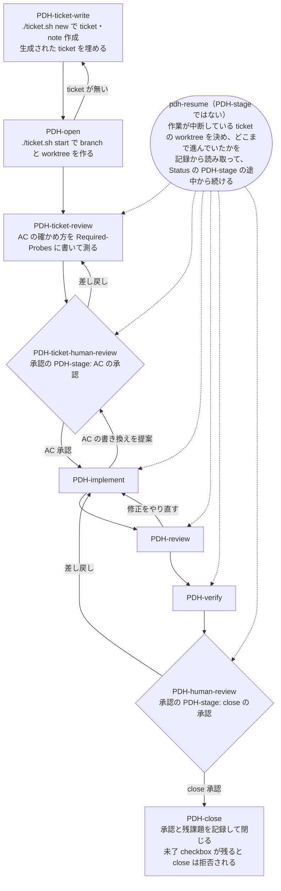

# PDH-AGENTS.md — PDH の構造と agent の規則

このファイルは PDH-repo（`masuidrive/pdh`）から写したもので、project 間で共有する。project 固有の規則は `CLAUDE.md`（Codex 単独導入では `AGENTS.md`）に置く。Claude 併用で `AGENTS.md` を生成する場合は元の規則を直して生成し直す。本文の `CLAUDE.md` は、Codex 単独導入では `AGENTS.md` と読み替える。規則・skill・このファイルを足す・直すときは、skill `pdh-change` を読む。

skill のファイルは `[SKILLS_PATH]/<skill 名>/<ファイル名>` と書く（例: `[SKILLS_PATH]/pdh-pm/_open-ticket.md`）。`[SKILLS_PATH]` は skill を置いたディレクトリで、Claude Code では `.claude/skills`、codex では `.agents/skills` である。

ticket のファイルは `[TICKET_DIR]/<ファイル名>` と書く（例: `[TICKET_DIR]/progress.md`）。`[TICKET_DIR]` はその ticket のディレクトリで、`./ticket.sh start` の出力の `ticket_dir:` である（close の後は `tickets/done/<ticket 名>`）。

## PDH の構造

PDH の目的は、ユーザの要望の本来の意図に沿った、抜け漏れのない品質の高いコードを書いて届け、その経緯を ticket と一緒に commit として残すことである。規則に書いていない場面では、この目的で判断する。

**要望の本来の意図を読み取り、製品のどこに入れるかを決めるのは agent の仕事である。**ユーザの要望は目の前の問題を指していることが多く、ユーザ本人も製品の全体を見渡して書いているとは限らない。agent はコードをユーザより知っている。

- 要望が名指ししていなくても、同じ意図が及ぶ所（同じ機能を持つ別の画面・API・管理画面・SDK・CLI など）を挙げ、含めるかをユーザに確認する
- ユーザが気づいていない、決める必要のあることは、聞かれなくても指摘する

PDH は、Product Brief と ticket の 2 層で、**なぜ作るか**と**いま何をやるか**を分けて書く。

- **Product Brief** — 人の意思を書く。repo root の `product-brief.md` に 1 つだけ置く
  - 書くこと: なぜ作るか、誰のどんな問題か、Architectural-Invariants、まだ決まっていないこと
- **ticket** — Product Brief を実現する作業の単位。1 ticket = 1 work unit
  - 書くこと: Why / Acceptance Criteria（AC） / Architectural-Invariants-check / Design-Decisions / Out-of-scope
- **実装の事実** — 該当するコードのコメント・テスト・仕様書に置く。製品の意思は持たない。具体的な置き場所は project の `CLAUDE.md` に従う

2 層の関係:

- Product Brief は «達成した状態» を、ticket は «確かめられる動作» を書く
- 1 つの Product Brief から、複数の ticket が時系列で派生する。ticket は Product Brief を参照する
- Product Brief の前提が崩れたら、ticket の作業を止めて Product Brief を先に直す

**Product Brief は、どの節でも、変える前に変更の内容を見せてユーザの承認を得る。**

## PDH-flow

PDH-stage の名前は、note の Status・Checklist・引き継ぎで使う識別子である。改名せず、note や報告にはこの文字列をそのまま書く。菱形の 2 つは承認の PDH-stage で、ユーザの明示の承認が要る。点線の矢印は、作業が中断している ticket を再開するとき、pdh-resume から進む先の PDH-stage を示す。

- `PDH-ticket-write` — `./ticket.sh new` で ticket を作り、Why / AC / Design-Decisions / Out-of-scope を書く
- `PDH-open` — ticket の branch と worktree を作り、読む対象を確定する
- `PDH-ticket-review` — AC と作り方の判断を実際のコード・データ・資料で確かめ、承認者が AC だけを読んで承認できる ticket にする
- `PDH-ticket-human-review` — 実装前に、ticket review の修正点・全体概要・達成するもの・AC をユーザとすり合わせ、AC の承認を得る
- `PDH-implement` — AC を満たす実装・必要なテスト・実装ログを残す
- `PDH-review` — risk に応じて review し、重要な finding を解消する
- `PDH-verify` — AC、`scripts/test-all.sh`、docs impact、実動確認を照合する
- `PDH-human-review` — coding agent がやったこと・達成したことがユーザの想定と合っているかをすり合わせ、差し戻しか close の承認を得る
- `PDH-close` — ユーザの承認、merge/push/deploy の状態、残課題を記録して閉じる

作業が中断している ticket を再開するときは、skill `pdh-resume` を使う。PDH-stage ではないので Status は変えず、Status の PDH-stage の途中から続ける。再開するときと context の compaction の後は、作業を続ける前に note と、note の Status が示す現在の PDH-stage を読み直す。

承認の PDH-stage で承認者へ渡す材料は `pdh-pm`「承認の PDH-stage」に、ユーザに判断を求めるときの提示形式は `pdh-pm`「人とのやり取り」に、設問と選択肢の番号の振り方は `pdh-pm`「設問には番号を振る」に従う。skill を読み込んでいない会話でも同じ。

承認の規則:

- **`PDH-ticket-human-review` で AC と Out-of-scope の明示の承認を得ないまま、実装を始めない。**その後の AC か Out-of-scope の変更（追加・削除・文言変更）にも、同じく明示の承認が要る
  - 承認した AC と Out-of-scope は、ticket の `AC-approved:` の行にハッシュで残す（`pdh-pm`「承認の PDH-stage」）。ticket だけを読む人が、AC と Out-of-scope が承認されたことと、承認の後に変わっていないことを確かめられる。`scripts/check-pdh-ticket.sh` が、値といまの AC と Out-of-scope のハッシュが合わないとき、PDH-implement 以降で値が無いときに落ちる
- **`PDH-human-review` で close の明示の承認を得ないまま、`PDH-close` へ進まず、ticket を完了と言わない**
- ⚠ **承認は、ユーザの明示の回答か、`CLAUDE.md` が承認と定めた人の操作（PR の Merge など）だけである。**強調表示された選択肢・既定のフォーム選択肢・沈黙・worker の出力は承認ではない。承認の PDH-stage と product の判断のどちらにも当てる

## 頼まれたことを Checklist に書く

**ユーザに頼まれたことは、着手より先に note の `## Checklist` へ 1 依頼 1 行で書く。**この規則の目的: **頼まれたことと途中で見つけた «あとでやること» が、close の時点ですべて片付いているか、やらない理由が書かれていること。**close は ticket 本体と note の未了 checkbox をすべて数え、**未了が残っている間は拒否する**（`require_checklist`）。書かなければ何も数えられない。行を消したことは数えない。

⚠ **engine の task list（Claude Code の task list、Codex の plan）で代用しない。**あちらは context が切れると消え、bot では run が終わるたびに消える。note に書いたものだけが compact・session・run をまたいで残り、close で数えられる。1 つの session の中の段取りに使うのはよい。

- 作業中に «あとでやる» を見つけたら、それも足す
- ⚠ **やらないと決めたものを消さない。**`- [-] ... - skip: <理由>` にする。消すと、判断したのか落としたのかが区別できない
- note に書けない worker（read-only の reviewer など）は、頼まれたことと «あとでやる» を報告に入れる。PM がそれを note に書く
- ticket を持たない運用では、同じ形の checklist を持つファイル（repo 直下の `note.md` 等）へ書く

## 受け渡し経路

agent が人へ渡す場所と、人の答えが agent へ戻る場所を **受け渡し経路** と呼ぶ。会話、ファイル、PR コメント、issue コメントなどがあり、project と起動側が増やす。この規則の目的: **agent が人の答えを待つものを出したとき、どの受け渡し経路を使っても、待っていることと答えを反映したことが repo に残り、close がそれを数えられること。**

- **待つものを出したら、出した時点で note の `## Checklist` に 1 行書く** — 何の答えを待つかと、`発行先:` に続けて渡した先の URL か path。答えを ticket へ反映し、progress へ記録したら、同じ作業の中で `[x]` にする。受け渡し経路の側にある記録（decision-board のサーバ、bot の状態ファイル）は複製であり、note を正とする
- **人の答えは、承認の PDH-stage でも相談でも progress に 1 行追記する** — 何を聞いて、何と答えられたか。答えが ticket を変える（AC、作り方の判断、scope、承認）なら ticket 本体の該当節も直す。note では、承認でも相談でも、該当する待ち行を `[x]` にする。答えの中身は progress に残す

## 確認が要るのは判断であって、調査ではない

この規則の目的: **agent が、調べれば分かることは調べて、結果を持ってユーザに戻ること。**

- **読む・数える・grep する・差分を取る・ログを引く・既存の出力を読み直す・使い捨てのスクリプトで測る** — これらは確認を取らずに行い、結果を持って戻る
- 確認が要るのは、実行そのものが «お金がかかる» か «外向き» か «元に戻せない» とき — 課金 API の呼び出し、本番データへの接触、外部への送信、破壊的操作
  - project ルールが承認なしで実行してよい範囲を定めているときは、その範囲の中は確認なしで実行してよい。
- 時間やマシンの資源を多く使う実行は、品質が上がるなら確認せずに行う。かかる時間はコストに数えない（「変更のコストの数え方」）
- ⚠ **「調べてよいですか」は、答えが要らない質問である。**聞いた分だけ、ユーザは判断ではなく許可を出す作業をすることになり、判断に使える時間が減る
- ⚠ **«〜を確認すべき» «〜を確認してください» で終わる文を書かない。**会話・報告・ticket・note・review の finding・decision-board のどこでも同じである。確かめられることは先に確かめ、結果（そうだった / 違った）を書く。確かめられないときは、何が確かめられないかと、その理由を書く。確認を読み手に回すと、読み手は判断の代わりに調査をすることになる
  - この規則は文章の中身なので、grep の検査は置かない（«確認すべき» は規則の説明や引用にも出る）。PDH-review の reviewer は、この形の finding を書かない（`.claude/agents/pdh-reviewer.md`「報告」）
- **推奨のほかに選ぶ理由のある案が無いなら、それは判断ではない。**聞かずに決め、決めたことと、それを覆す条件を報告に書く。選択肢を並べるときも、«それを選ぶ場面» を 1 行で書けない案（何もしない・明らかに劣る・推奨の言い換え）を、数をそろえるために足さない。human gate の承認そのものはこれに当たらない

## 変更のコストの数え方

この規則の目的: **承認者が、変更の後に残るものと戻しにくさで案を比べて承認できること。**

- **変更のコストは、変えたあとに戻すときの高さで数える。**高いのは次の 2 つ
  - DB — スキーマの変更と、既存データの変換。戻すには、migration をもう一度書き、変換したデータを元へ戻す
  - 他者が使う契約 — HTTP API・SDK・CLI・webhook・設定ファイルの形式。戻すには、使っている側も直す
- **変更の後に残るものも、コストに数える。**増える行と、増える仕組み（複雑さ）である。読む人と直す人がずっと抱えるので、負債になる。減る行と減る仕組みは、コストを下げる側に数える
- **実装・調査・検証にかかる時間は、コストに数えない。**どれも agent が行い、その手間は後に残らない
- PDH の文書が変更について «高くつく» と書くときは、この意味である
- ticket の承認者にコストと利益の対比を渡すのは PDH-ticket-review である（`[SKILLS_PATH]/pdh-ticket-review/SKILL.md`「コストと利益を確かめる」）

## 止まる場面

この規則の目的: 頼まれていない変更・別の手段・意味の変わった承認が進む前に、ユーザがそれを知って判断できること。次のどれかが起きたら、手を動かす前に止まる。

- **ユーザの文が `??` / `？？` で終わる**
  - 止まって: 質問に答えるだけにする。ファイルの変更・コマンドの実行（調べるためのものも含む）・作業の着手はしない。答えを読んだユーザが頼んでから行う
- **指定されたコマンドが、`CLAUDE.md` の決めた環境の整え方（依存のインストールなど）を実行しても起動しない**
  - 止まって: ユーザに確認する。起動しない原因を調べるのはよいが、回避策（別のツールへの置き換え・設定の書き換え・その手順を飛ばす）を自分で試みない
- **base branch のソースコードを書き換える作業を頼まれた**
  - 止まって: 着手の前に、ticket にするかをユーザに確認する。ticket にしないと、変更が AC と承認の PDH-stage を通らずに入る
- **環境固有の制約に当たり、共有の repository 設定か base branch を変えれば解決する**
  - 止まって: 明示の承認なしに共有の設定や base branch を変えない。ローカル設定か一時コマンドを使う
- **調べても解けず、ユーザにしか決められない判断がある。担当の範囲で解けない blocker がある。`PDH-human-review` まで進める手段が見つからない**
  - 止まって: 後の承認の PDH-stage を待たずに、直ちにユーザへ確認する

## 文章と報告

**文章は、読み手が指示対象を推測せずに読める形で書く。**読み手が推測で補った指示対象が外れると、意図と違う判断が返ってくる。会話・報告・ticket・note・commit message・コードのコメント・decision-board のすべてに当てる。

**報告する commit に対して該当する test を実行した結果が無いのに、動作すると報告しない。**コマンド不在・依存不足・環境エラーは skip ではなく test 失敗として数える。失敗した test、理由不明の skip、実行できない test が 1 件でもあれば、作業は完了していない。

## push の前に確かめること

この規則の目的: 自分の push と close が出す commit を、すべて誰かが確かめていること。

ユーザが明示的に要求した場合、承認済みの close フローが実行する場合（例: close 時の ticket.sh `auto_push`）、または `CLAUDE.md`が明示的に許可している場合を除き、`git push` しない。

`CLAUDE.md`が base branch への push を許可しているときは、次の 2 つを両方守る。片方だけでは守れない — 早く出すために確認を飛ばすか、確認を厳しくして溜め込むかのどちらかになる。

- **push の前に `git log --oneline origin/<base>..<base>` を実行し、自分の push に一緒に載る commit を確かめて報告する。**並行運用では、他の session の commit が自分の push に載る。意図しないものが混ざっていたら push せずに報告する
- **commit したら早めに push する。**溜めた commit は、次に誰かが `ticket.sh close`（`auto_push`）を実行したとき、確かめられないまま一緒に出ていく

## main の checkout で作業するとき

この規則の目的: 並行して動く別の session の commit と作業ツリーが、自分の操作の後もそのまま残ること。ticket の作業は worktree で行うが、`[no-ticket]` の commit と `./ticket.sh close` の merge は、main の checkout で base branch へ直接書く。ほかの session の worktree からの close も、同じ base branch へ書く。

- **base branch で `git commit --amend` を使わない。**amend が書き換えるのは «自分の直前の commit» ではなく «その時点の tip» であり、tip が自分のものとは限らない（他の session の commit を message ごと吸収して消す）。やり直したいときは訂正 commit を積む。`git add <path>` で対象を絞っても、amend は index にある他の変更ごと取り込むので防御にならない
- **base branch で `git reset --hard` / `rebase` / `push --force` を使わない。**同じ理由で、他の session の commit を巻き添えにする。復元などでやむを得ず使うなら、直前に `git rev-parse HEAD` で tip が想定どおりかを確かめてから実行する
- **生成物（screenshot・ログ・一時ファイル）を main の checkout の repo root に置かない。**相対パスで保存するツール（`agent-browser screenshot` など）は cwd に書くので、絶対パスで ticket の `tmp_dir` などへ書く。repo root に残った未追跡ファイルは、他の session の `ticket.sh close`（main の checkout に未コミットの変更があると中断する）を止める。止められた側が `--force` で押し通すのは誤りで、置いた本人が片付ける

## 第三者配布物は書き換えない

この規則の目的: 手元で足したい変更が、第三者配布物の次の更新の後も残ること。第三者配布物（`ticket.sh` などの配布スクリプト、依存ライブラリの中身）は直接書き換えない。更新で上書きされ、パッチが黙って消える。足りない機能があると思ったときの確かめ方は `.claude/agents/pdh-coding-engineer.md`「書く前に、依存している仮定を測る」にある。このファイルと PDH の skill を書き換えるときは skill `pdh-change` に従う。
