# Brief の利用場面を完成させる

PM（親エージェント）が全体の進行を担う。各ステップの結果を人間（依頼者）に報告し、続けて次の作業に着手する。人の判断が必要なときは会話で質問し、回答を待つ間も独立した作業を進める。

```mermaid
flowchart TD
    subgraph flow["PM が進めるチケット"]
    agree["agree-scope<br/>利用者に約束する結果を決める"]
    plan["plan-tests<br/>試す操作と期待結果を決める"]
    build["implement-change<br/>利用者の入口から動くようにする"]
    verify["verify-behavior<br/>候補版で各ACを確かめる"]
    review["review-counterexample<br/>独立した読み手が選んだ反例を試す"]
    ready["check-readiness<br/>正式検収を経て提出可否を確かめる"]
    close["close-ticket<br/>人の承認を記録して閉じる"]

    agree --> plan --> build --> verify --> review --> ready
    build -->|約束を変える必要がある| agree
    verify -->|実装がACに違反| build
    review -->|反例で違反を確認| build
    ready -.->|初回 hold| verify
    verify -.->|再確認の証拠がそろった| ready
    end
    human["人間（依頼者）"]
    flow -.->|各ステップの結果を報告・必要な判断を質問| human
    ready -->|達成したこと・証拠・対象版を提示| human
    human -->|対象版の close を承認| close
    human -->|実装の差し戻し| build
```



新規の実装は `agree-scope` から始める。再開時は `./ticket.sh start <名前>` で既存の worktree に戻り、`progress.md` と候補版の証拠から、残っているステップを続ける。worktree のリンクは `./ticket.sh restore` で復元できる。実行履歴についての質問なら、記録を読んで答える。

**ステップ終了時の報告**　各ステップを終えるたびに、その場で利用者との会話に次の形式を1回出してから次の作業に移る。`finished` は今終えたステップの見出し名、`next` は実際に進む先の見出し名とし、英語の `kebab-case` のまま書く。開始タグの直後と終了タグの直前で改行し、本文には実施した作業と、その結果または成果物を簡潔に書く。

```xml
<report finished="plan-tests" next="implement-change">
保存後に画面を開き直す操作と、保存内容を照合する方法を checklist.md に記録した。
</report>
```

差し戻すときは、その理由を本文に添え、`next` に戻り先を書く。再実行したステップも終えた時点で報告する。ステップの途中で人の回答や観察を待つ場合は、未確認の内容と必要な操作を伝え、終了報告はそのステップが終わるまで待つ。最後は `./ticket.sh close` が成功した時点で `finished="close-ticket" next="done"` とする。`done` は後続ステップがないことを示す終端値。

## 利用者からメッセージを受けたとき

- メッセージを受けるたびに、これまでの会話を踏まえ、利用者が何を意図し、どんな結果を得たいのかを考える。
- 作業に入る前に、その意図とゴールを自分の言葉で利用者に短く復唱する。進行中の作業への追加指示や訂正を受けたときも、再開前に復唱する。
- 意図とゴールが読み取れれば、そのまま進める。結果を左右する解釈が複数残るときは、その違いを Q 番号付きで尋ねる。

## agree-scope

**目的**　誰が何をできるようになれば完了かを、利用者と実装者が合意する。

**作業**　`product-brief.md` を読み、使う人と困り事、完成時の操作と結果を1文で言えるようにする。Brief を作るときは許せない失敗・許せる費用・外部制約と、製品の判断が変わる具体例も書く。実装手順は開発文書に置く。新規なら `./ticket.sh new` で起票し、今回の完了条件（AC）を `tickets/<名前>/scope.md` に1条件1行の `- 条件` で書く。画面・API・CLI 等から観察できる結果にし、対象の人・環境・接続先が複数ならそれぞれを含める。依頼から決まる条件はそのまま使い、意味が定まらない条件だけ人に聞く。

**成果物**　Brief と scope を含む commit を作り、その完全な SHA を `progress.md` に `- 初回合意 | 完全SHA` と記録して commit する。利用者が何を判断・実行し、どんな失敗がその判断に響くかも1〜2行残す。Brief にあれば参照でよい。時間の予算があれば開始時刻と人に戻す時点も控える。

**次へ**　初回の合意後、`./ticket.sh start <名前>` で worktree に移り、`plan-tests` へ進む。途中でこのステップに戻った場合は、利用者が変更を明示的に選んでから Brief または scope を改訂し、初回合意の SHA を保って再合意を記録する。変更に依存しない作業は続ける。[チケットの操作手順とACの再合意](../../USAGE.md#実装中にacを見直すとき)

## plan-tests

**目的**　どんな結果が出たら実装の誤りに気づけるかを、実装前に決める。

**作業**　[実装者用の指示](references/implementation.md) に沿って、普通に使う一往復を最初の操作から最後の判断までたどる。利用者がその前にどこで作業し、どんな状態を引き継ぐかを checklist に一文で書く。起動元、権限、既存データなどが成否を変える場合は、その条件を保った隔離環境で試す。途中の表示や応答が食い違うと利用者の判断が変わる境界を選ぶ。実機や本人の操作が要るなら、どの候補版で、誰がいつどう確かめるかを見通しておく。

**成果物**　`checklist.md` の `- [ ]` に、試す操作、正しさを照合する別の事実、途中で何が見えれば失敗かを書く。既存試験があればその名前を使う。[試験計画と例](../../USAGE.md#試験計画)

**次へ**　担当者が操作と成功・失敗を判断する根拠を説明できたら、`implement-change` へ進む。

## implement-change

**目的**　利用者が普段使う入口から、約束した結果までを実際に動かす。

**作業**　最小の一往復を通し、対象ごとに早く実物を見る。委譲時は利用者が得る結果、担当範囲、Brief・AC の場所を示し、作業先の `pdh/skills/pdh/references/implementation.md` を読んで実装と試験を選ぶよう依頼する。読めない場合は本文を渡す。実装中は影響する試験を回し、作り方・調査・やり直しは担当者が決める。

**成果物**　利用者の入口から実行できる製品候補と、今回の変更で必要になった試験。製品と試験を commit し、観察する版を特定する。

**次へ**　候補を `verify-behavior` で試す。元の AC を満たせる不具合は同じチケットで直す。外部仕様などで実現不能と分かったり、AC を変える方が製品目的に合うと分かったりしたら `agree-scope` に戻る。利用結果・許容する失敗の変更、未承認の費用や外部への影響は人に判断を求める。

## verify-behavior

**目的**　候補版の利用者が各 AC の結果を得られるか、実際の操作から確かめる。

**作業**　計画した操作を行い、期待結果と照合する。遅れや失敗が判断を変える場面では途中の表示と実際の状態も見る。既存の結果で足りる範囲を先に調べ、不足する場面だけを追加する。

- **application test** は、close 後も製品が守る振る舞いを通常スイートで検査する。既存試験で違反を検出できれば追加は0件。漏れる失敗は検出できる最も軽い層で既存試験を広げるか代表例を一つ足す。他の層や条件に広げるのは、そこだけで別の失敗が起こる場合。遅い試験を常設する前に実行時間を測り、軽い試験で拾えない失敗を明らかにする。
- **ticket test** は、今回の AC や反例を確かめる実機操作・計測・故障の再現に使う。再実行するコードは `tickets/<名前>/tests/` に保存し、commit した版で観察する。worktree では `./current_ticket/tests/` から参照できる。`./pdh/scripts/test-ticket-local.sh` はチケットの実行可能な `tests/test-ticket-local.sh` を呼ぶ。一つの操作で複数の AC を確かめてよい。製品と通常スイートは ticket test に依存させない。

**成果物**　各 AC と試した場面を `tests/coverage.tsv` に対応付け、結果を `coverage-results.json` に結び付ける。`evidence.md` に手動操作や専用スクリプトの実測を `- 条件の原文 | 観察した完全な commit SHA | どの入口で何と比べ何を観測したか` の形で1条件1行にまとめる。実データは許可済みの隔離環境を使い、機密を除いて順序・差・時間を残す。`checklist.md` は確認済みを `[x]`、対象外を `[-]` とし、直下の `  根拠: …` に観察結果か対象外の理由を書く。[実行結果の収集と対応付け](../../USAGE.md#シナリオと実行結果)

**次へ**　各 AC を裏付けたら `review-counterexample` へ。違反は `implement-change` に戻す。実機や予算の制約で確かめられない条件は `[ ]` に残し、候補版・必要な操作・観察したい結果を人に渡す。正式検収からの再確認では、指摘と変更が影響する範囲を確かめ、新しい証拠を持って `check-readiness` に戻る。

## review-counterexample

**目的**　AC の試験が通っても、実際には利用者が判断や操作を誤る場面が残っていないか確かめる。

**作業**　実装時の会話を引き継がない subagent に Brief・AC・既知の制約・候補の差分とテストコード・試してよい環境を渡す。実装者の合否判断・試験結果・PM の close 判断は先に伝えず、試す場面を一つと、その操作で何が見えれば失敗かを返してもらう。読み手は差分が触れる既存の使い方と、試験の準備が普段の利用と異なる箇所もたどる。成否を変えうる違いがあれば、その具体的な操作と利用者への影響を根拠に反例を選ぶ。既存機能の退行を見つけたら記録し、今回の変更が起こした退行は修正する。利用者と同じ入口で試す。反例を新しく探すのは作業ごとに原則1回。修正後は検証担当に既知の再現手順を渡し、旧版で失敗した操作と通常の操作を照合する。

**成果物**　`evidence.md` の `## 反例確認` に `- 判定 | 製品の完全SHA | 試した操作 | 観察結果 | 処置` を1行記録する。`問題なし` は観察した範囲を示す。AC を満たして残る制約は製品の known-limits に残す。`許容` の処置には `影響 / 回避 / 再判断条件` を書き、回避できなければその旨を書く。

**次へ**　`要修正` は `implement-change`、`約束変更` は `agree-scope`、`未確認` は `verify-behavior` に戻す。既知の違反を解消し、判定が `問題なし` または `許容` になったら `check-readiness` へ。

## check-readiness

**目的**　候補版を人に完了として提示できるか、全体試験と独立した検収で判断する。

**作業**　worktree で `WORK` をチケットの相対パス、`AGREED` を初回合意の完全 SHA として次の順で進める。

1. `python3 pdh/scripts/pdh.py test "$WORK" "$AGREED"` で製品の `scripts/test-all.sh` を実行する。製品・application test・通常スイートの実行条件を変えたら最終候補で全体を1回通す。ticket test だけを追加・変更した場合は通常スイートの成功を使えるが、変更後の版での AC と反例の観察が要る。製品と独立した説明の修正として同じ結果を使えるファイルは `pdh/scripts/pdh-prose.txt` にある。
2. `suite-pass` と検証・反例の記録を commit する。新しく合意したチケットは `./ticket.sh decision` で送信資料を確認し、同じコマンドに `--send <表示されたハッシュ>` を付けて判定を取得する。Claude 単独はプレビュー・送信とも `--backend claude`、Codex 単独と混成は `--backend codex` を使う。macOS で正式検収する場合は最初のプレビューから `--backend responses` を選び、OpenAI API キーを用意する。検収者は実装の会話を引き継がない。[独立検収の操作手順](../../USAGE.md#独立検収)
3. 判定を commit し、`python3 pdh/scripts/pdh.py ready "$WORK" "$AGREED"` を実行する。導入前に合意したチケットは当時の検収条件に従う。

**成果物**　`suite-pass` は全体試験に通った版、`decision.json` は正式検収の判定と理由を示す。`ready` は記録が合意と候補版に対応しているかを確かめる。

**次へ**　送信前のチェックで止まったら、未達の条件を担当するステップに戻る。この時点では正式な判定は出ていない。初回の `hold` は対象の AC か反例に戻り、新しい観察で再確認を1回行う。再び `hold` なら未解決の条件と証拠を人に戻す。`ready` が通ったら `close-ticket` へ進む。

## close-ticket

**目的**　利用者が確認できた版について、人が完了を判断する。

**作業**　`ready` が通ったら、PM は完了承認の依頼を「このチケットで達成したこと」から始める。起動元や権限など、結果を左右した試験の開始条件を添える。普段の使い方を含む達成を提示するには、その条件からの観察が要る。約束に含む条件を確認できていなければ検証に戻る。対象の利用者・環境を示し、どんな場面で何ができ、その結果をどう確かめられるようになったかを具体的に書く。各成果に「利用者が確かめる方法」を添える。開始場所（リンクや作業ディレクトリ）、必要な準備、操作、成功したと分かる表示や結果を書く。本人が実際に確認した範囲と、チームが試験で確認した範囲を明示する。通信断など手元で再現しにくい条件には、該当試験の再実行方法か結果を直接読めるリンクを添える。懸念や引き継ぎたいメモがあれば、承認の前に添える。未確認の条件や原因不明の現象は、何を観察したか、利用にどう影響しうるか、分かっている範囲で書く。回避策・再調査の条件・利用上の前提があれば一緒に残す。該当する事項がないときは欄を省いてよい。最後に候補版を示し、その版を閉じてよいかを聞く。差し戻しなら理由に対応するステップへ戻る。

**成果物と終了条件**　対象版への明示の承認を得たら、返答と版を `progress.md` に記録して commit する。チケットの worktree で `./ticket.sh close` を実行し、成功したら完了。通常の close は `ready` を呼ぶ。

## 質問と引き継ぎ

相手の返事が必要になったら、送る直前に実際の文面を確認する。

- 何について判断・観察結果・値を返してほしいかが分かるか。
- 初めて聞くことに、この会話の次の Q 番号が付いているか。すでに聞いた問いを案内し直す場合は、元の番号が分かるか。
- 独立した答えが必要な点を分け、各番号に返答例と、その答えで次に何をするかを書いたか。

利用者は複数の仕事を並行している。質問・作業依頼・承認依頼は、後からその一件だけを開いても判断・操作できるように書く。質問カードを使う場合も、判断に必要な説明をカードの中に入れる。

- **件名**には製品名、対象のチケットや機能、決めてほしいこと（または頼みたい操作）を書く。
- **背景と理由**には、利用者が実現したいこと、どこまで確認できたか、なぜ今その人の判断や操作が要るかを書く。チケット番号や「先ほどの案」だけで済ませず、判断を左右する事実や制約をその場で説明する。
- **依頼と返し方**には、判断なら選択肢ごとの結果、操作なら対象の版・開く場所・手順・何が見えれば成功かを書く。最後に、何を返せばよく、その返事で作業がどう進むかを示す。

一つの質問番号で求める答えは一つとする。判断・観察結果・値を複数返してほしいときは、同じメッセージでも問いを分ける。新しく質問するたびに、同じ会話で最後に発行した番号の次（`Q1`、`Q2`…）を使う。追加質問、聞き直し、どの問いへの回答かの確認にも新しい番号を振る。過去の問いを参照するときは元の番号を添えてよい。できるだけ選択式にし、1番と2番以降に実行可能な案を並べ、選ぶと何が起きるかを書く。推す理由があれば1番に「(推奨)」と理由を添え、推奨がなければ印を省く。`Q3=2` のように答えられるようにし、自由な返答も受け付ける。本人しか知らない値や事情は自由記述で聞く。

案を比べるとき、変更コストには、元に戻す難しさ（既存データの移行、外部が使う API・CLI の契約など）と、導入後も保守するコードや仕組みを数える。エージェントの実装・調査・検証にかかる時間はこの指標から除く。本人の作業・待ち時間、期限、追加の計算料金が選択を左右するときは別に示す。

作業中は、選んだ場面、追加で見つけたこと、提出判断の変化、所要時間を `progress.md` に残す。手順の効果を調べるときは対象チケットと観察期間を決め、独立レビューで初めて見つけた不具合、close 後に利用者が初めて見つけた不具合、正式検収の回数をチケット単位で振り返る。利用実績が足りない項目は未観察と記す。中断するときは基点、最後に動いた場面、残る条件、再開時の一手を同じファイルに書く。
